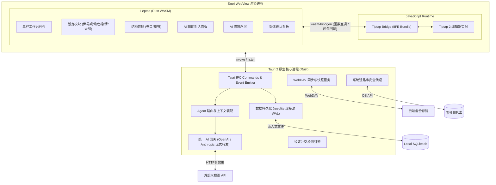
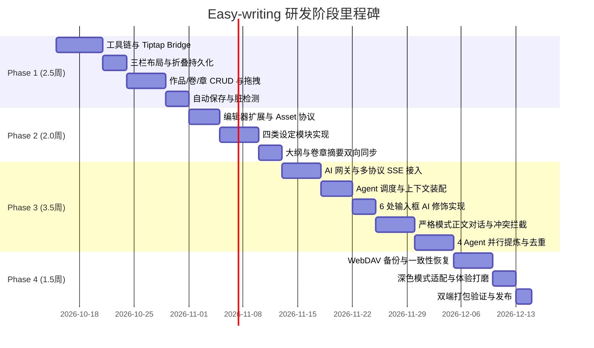
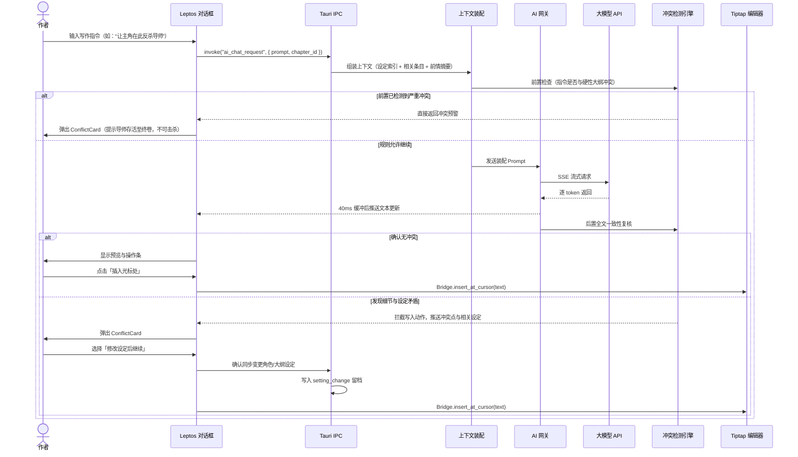
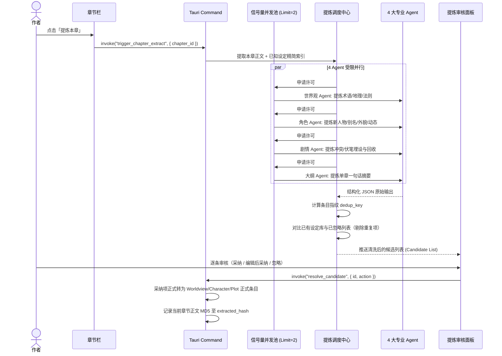

# Easy-writing · 中长篇小说工作台 — 实施计划（终版）

> 基于 [框架方案与 PRD](file:///Users/roy/Downloads/%E7%9F%AD%E7%AF%87%E5%B0%8F%E8%AF%B4%E5%B7%A5%E4%BD%9C%E5%8F%B0%20%C2%B7%20%E6%A1%86%E6%9E%B6%E6%96%B9%E6%A1%88%E4%B8%8E%20PRD.md) 设计 · 已通过工程架构审核并完成 6 项细节修正  
> 日期：2026-10-14 · 作者：Roy & AI Pair Programming

---

## 目录

1. [项目定位与核心决策](#一项目定位与核心决策)
2. [技术选型与工具链](#二技术选型与工具链)
3. [系统架构与关键工程设计](#三系统架构与关键工程设计)
   - 3.1 总体架构图
   - 3.2 Tiptap Bridge 与构建流水线设计
   - 3.3 编辑器生命周期与切章策略
   - 3.4 Tauri 2 本地资源协议（Asset Protocol）
   - 3.5 AI 网关流式节流与并发限流（Semaphore）
4. [项目目录结构](#四项目目录结构)
5. [数据库 Schema（完整 DDL）](#五数据库-schema完整-ddl)
6. [分阶段实施计划（4 阶段 · 9.5 周）](#六分阶段实施计划4-阶段--95-周)
   - Phase 1：基础骨架与跨语言 Bridge（2.5 周）
   - Phase 2：核心编辑与设定同步（2.0 周）
   - Phase 3：多 Agent 调度与 AI 能力（3.5 周）
   - Phase 4：WebDAV 同步、深色模式与发布（1.5 周）
7. [核心业务时序图](#七核心业务时序图)
8. [P1 功能与后续排期](#八p1-功能与后续排期)

---

## 一、项目定位与核心决策

### 1.1 定位
Easy-writing 是一款面向独立中长篇小说创作者的**本地桌面工作台**。核心理念在于“**设定自己长出来、结构清晰、多 Agent 分工协作、数据完全自主**”。

### 1.2 确定决策项
* **应用形态**：Tauri 2 桌面应用（首发适配 macOS 与 Windows，单用户本地版）。
* **前端架构**：**Leptos 0.7 (Rust → WASM) + Tiptap 2 (JS 核心编辑器混搭)**。
* **单部体量支撑**：按 **100 万字 / 300 章节** 进行数据流与视图渲染性能基准设计。
* **设定冲突改动**：改动前后保留留档（`setting_change` 表），撤销 UI 交互列入 P1。
* **导入外部稿件**：MVP 暂不包含批量解析，留作 P1 功能。
* **外观主题**：支持浅色模式与深色模式（Tailwind `dark:` 规范，Phase 4 交付）。

---

## 二、技术选型与工具链

| 层级 | 选用技术 | 选型理由与工程考量 |
|---|---|---|
| **桌面运行时** | Tauri 2.x (Rust) | 原生安全性高、打包体积小（~15MB）、系统资源消耗低。 |
| **前端 UI 框架** | Leptos 0.7 (CSR, WASM) | 细粒度响应式系统（Fine-grained reactivity），全栈 Rust 类型共享，零虚拟 DOM 负担。 |
| **前端构建与热更** | Trunk 0.21+ | Rust WASM 构建流水线标准工具，管理 HTML、WASM 编译产物。 |
| **富文本核心** | Tiptap 2 + ProseMirror (JS) | 业界成熟度最高的可扩展文档模型，原生 JSON schema 完美对接底层存储。 |
| **JS 打包工具** | esbuild | 超高速构建，将 Tiptap 与 Bridge 打包为自包含 bundle，供 Trunk/WebView 引入。 |
| **UI 样式库** | Tailwind CSS 4 + Leptonic | 原生 utility-first 样式，配合 Leptos 响应式组件库构建现代化桌面质感。 |
| **本地数据库** | SQLite 3 (`rusqlite` + `r2d2`) | 单文件本地存储、ACID 保证，天然契合 WebDAV 整库镜像同步。 |
| **数据库迁移** | `refinery` | 嵌入 Rust 二进制的轻量级 SQL 版本迁移工具。 |
| **系统安全存储** | `keyring` crate | 跨平台接入 macOS Keychain 与 Windows Credential Manager，敏感凭据永不入库。 |
| **网络请求** | `reqwest` (异步流式) | 承载 OpenAI/Anthropic 协议的 SSE 解析与 WebDAV 协议交互。 |
| **通信与序列化** | `serde` / `serde_json` | Rust/WASM/JS 统一序列化规范。 |

---

## 三、系统架构与关键工程设计

### 3.1 总体架构图



---

### 3.2 Tiptap Bridge 与构建流水线设计（已修正）

为解决 Trunk 无法直接打包 npm 模块的断层，采用 **`esbuild + Trunk hooks`** 两段式构建流：

```
[js/src/*.js + npm packages] 
       │ (esbuild bundle)
       ▼
[dist/tiptap-bridge.bundle.js] 
       │ (Trunk 静态注入)
       ▼
[index.html 运行时引用 window.TiptapBridge] 
       │ (wasm-bindgen 外部符号绑定)
       ▼
[src/bridge/tiptap.rs (Rust)]
```

#### Bridge Rust 声明示例 (`src/bridge/tiptap.rs`):
```rust
use wasm_bindgen::prelude::*;

#[wasm_bindgen]
extern "C" {
    #[wasm_bindgen(js_namespace = TiptapBridge)]
    pub fn mount_editor(element_id: &str, initial_json: &str, on_update_cb: &js_sys::Function);

    #[wasm_bindgen(js_namespace = TiptapBridge)]
    pub fn get_content_json() -> String;

    #[wasm_bindgen(js_namespace = TiptapBridge)]
    pub fn get_content_plain() -> String;

    #[wasm_bindgen(js_namespace = TiptapBridge)]
    pub fn get_word_count() -> u32;

    #[wasm_bindgen(js_namespace = TiptapBridge)]
    pub fn set_content(json_str: &str);

    #[wasm_bindgen(js_namespace = TiptapBridge)]
    pub fn insert_at_cursor(text: &str);

    #[wasm_bindgen(js_namespace = TiptapBridge)]
    pub fn replace_selection(text: &str);

    #[wasm_bindgen(js_namespace = TiptapBridge)]
    pub fn get_selection_text() -> Option<String>;
}
```

---

### 3.3 编辑器生命周期与切章策略（已修正）

* **禁止频繁销毁**：章节切换时，**不得**调用 `destroy_editor()` 重新挂载 DOM，避免白屏重绘和光标抖动。
* **优雅复用策略**：
  1. 监听到章节切换时，前端首先通过 Bridge 抓取当前草稿 JSON，执行后台脏检查并自动保存；
  2. 调用 `set_content(new_chapter_json)` 仅更新 ProseMirror 文档树；
  3. 重置本地 Undo/Redo 历史栈并更新状态栏字数。

---

### 3.4 Tauri 2 本地资源协议（Asset Protocol）（已修正）

本地图片存储在应用数据目录的 `images/` 子文件夹中。为了突破浏览器对于本地文件的安全隔离：
* 在 `tauri.conf.json` 中配置安全访问域：
  ```json
  {
    "app": {
      "security": {
        "assetProtocol": {
          "enable": true,
          "scope": ["$APPDATA/images/*"]
        }
      }
    }
  }
  ```
* 编辑器中引用的图片统一映射为：`asset://localhost/<rel_path>`，通过统一的相对路径保证 WebDAV 整库还原后跨设备可用。

---

### 3.5 AI 网关流式节流与并发限流（已修正）

#### 1. 流式更新节流（WASM UI 保障）
后端解析 SSE 数据块时，引入 40ms 时间窗口的合并缓冲区（Micro-batching buffer），按时间片向前端发送合并后的增量字符串，避免 100+ tokens/s 时产生的高频 IPC 和响应式渲染卡顿。

#### 2. 提炼并发控制（Semaphore 限流）
4 个 Agent 并行提炼本章时，使用 `tokio::sync::Semaphore(2)` 限制最大并发连接为 2，超出排队；单 Agent 发生 429 或网络异常时独立降级报错，保证其余 Agent 产出正常入库。

---

## 四、项目目录结构

```
easy-writing/
├── src-tauri/                          # Tauri Rust 后端（服务层）
│   ├── src/
│   │   ├── main.rs                     # 应用入口、插件注册、Commands 绑定
│   │   ├── db/                         # 数据库操作层
│   │   │   ├── mod.rs                  # 连接池、PRAGMA 初始化（外键 + WAL）
│   │   │   ├── schema.rs               # refinery 嵌入式迁移调用
│   │   │   ├── novel.rs                # 作品 CRUD
│   │   │   ├── volume.rs               # 卷目 CRUD
│   │   │   ├── chapter.rs              # 章节元数据与正文单独读取
│   │   │   ├── worldview.rs            # 世界观条目
│   │   │   ├── character.rs            # 角色卡与别名
│   │   │   ├── plot.rs                 # 剧情与伏笔状态
│   │   │   ├── agent.rs                # 预设 Agent 与提示词
│   │   │   ├── extraction.rs           # 提炼候选与去重指纹
│   │   │   ├── llm_profile.rs          # 模型接口管理
│   │   │   └── app_setting.rs          # 本地偏好
│   │   ├── ai/                         # AI 网关层
│   │   │   ├── mod.rs
│   │   │   ├── gateway.rs              # 统一转发与流式缓冲
│   │   │   ├── openai.rs               # OpenAI 兼容协议
│   │   │   ├── anthropic.rs            # Anthropic 兼容协议
│   │   │   ├── context.rs              # 上下文裁剪与相关度装配
│   │   │   └── consistency.rs          # 设定一致性检测（前后双检）
│   │   ├── agent/                      # Agent 调度层
│   │   │   ├── mod.rs
│   │   │   ├── dispatcher.rs           # Agent 路由分发
│   │   │   ├── polish.rs               # 6 处修饰提示词处理器
│   │   │   └── extraction.rs           # 4 Agent 提炼（带信号量限流）
│   │   ├── sync/                       # 同步模块
│   │   │   ├── mod.rs
│   │   │   ├── webdav.rs               # WebDAV 协议客户端
│   │   │   ├── backup.rs               # 快照备份（SQLite Backup API）
│   │   │   └── restore.rs              # 云端覆盖恢复与补图
│   │   ├── keyring.rs                  # OS 钥匙串读写代理
│   │   ├── asset.rs                    # 图片压缩、哈希与存储
│   │   └── commands/                   # 暴露给前端的 Tauri Command 集合
│   │       ├── mod.rs
│   │       ├── novel_cmd.rs
│   │       ├── chapter_cmd.rs
│   │       ├── settings_cmd.rs
│   │       ├── ai_cmd.rs
│   │       ├── sync_cmd.rs
│   │       └── config_cmd.rs
│   ├── migrations/                     # SQL 版本迁移
│   │   └── V001__init.sql
│   ├── tauri.conf.json                 # Tauri 2 核心配置
│   └── Cargo.toml
│
├── src/                                # Leptos 前端（Rust WASM）
│   ├── main.rs                         # 挂载入口
│   ├── app.rs                          # 根组件、布局组装
│   ├── components/
│   │   ├── layout/                     # 框架布局
│   │   │   ├── app_shell.rs            # 三栏布局容器
│   │   │   ├── left_panel.rs           # 左栏（设定）
│   │   │   ├── right_panel.rs          # 右栏（结构）
│   │   │   ├── writing_stage.rs        # 中间写作台
│   │   │   └── panel_toggle.rs         # 栏位折叠触发器
│   │   ├── settings_panel/             # 左栏四类设定
│   │   │   ├── settings_tabs.rs
│   │   │   ├── worldview.rs
│   │   │   ├── characters.rs
│   │   │   ├── plot_lines.rs
│   │   │   └── outline.rs
│   │   ├── structure_panel/            # 右栏卷章管理
│   │   │   ├── save_button.rs
│   │   │   ├── volume_list.rs
│   │   │   └── chapter_list.rs
│   │   ├── editor/                     # 写作工作区
│   │   │   ├── chapter_nav.rs          # 章节面包屑与快速提炼入口
│   │   │   ├── editor_wrapper.rs       # Tiptap 挂载容器
│   │   │   └── status_bar.rs           # 字数与保存指示器
│   │   ├── ai/                         # AI 交互视图
│   │   │   ├── chat_box.rs             # 严格模式正文对话框
│   │   │   ├── polish_button.rs        # 通用 AI 修饰按钮
│   │   │   ├── polish_diff.rs          # 修饰对比与采纳弹层
│   │   │   ├── extraction_panel.rs     # 提炼候选审核面板
│   │   │   └── conflict_card.rs        # 设定冲突裁决卡片
│   │   ├── config/                     # 设置视图
│   │   │   ├── config_page.rs
│   │   │   ├── llm_profiles.rs
│   │   │   ├── agent_settings.rs
│   │   │   └── webdav_config.rs
│   │   └── common/                     # 通用基础组件
│   │       ├── confirm_dialog.rs
│   │       ├── toast.rs
│   │       └── modal.rs
│   ├── state/                          # 细粒度响应式 Signal 上下文
│   │   ├── novel_state.rs
│   │   ├── editor_state.rs
│   │   ├── settings_state.rs
│   │   └── ui_state.rs
│   ├── bridge/                         # WASM ↔ JS 绑定声明
│   │   └── tiptap.rs
│   └── tauri_api/                      # Tauri Invoke 包装层
│       ├── novel.rs
│       ├── chapter.rs
│       ├── ai.rs
│       └── sync.rs
│
├── js/                                 # 富文本核心与依赖打包层
│   ├── src/
│   │   ├── tiptap-bridge.js            # 核心通信实现
│   │   └── extensions.js               # 自定义 ProseMirror 扩展
│   ├── package.json                    # Tiptap 依赖
│   └── esbuild.config.mjs              # 单文件 Bundle 配置
│
├── styles/
│   └── main.css                        # Tailwind 4 基础样式与 Prose 覆盖
│
├── index.html                          # 宿主页面
├── Trunk.toml                          # Trunk WASM 构建流水线配置
├── Cargo.toml                          # 前端 Crate
├── Cargo.workspace.toml                # Workspace 根配置
└── Docs/                               # 规范与设计归档
    └── Easy-writing · 实施计划.md
```

---

## 五、数据库 Schema（完整 DDL）

> [!IMPORTANT]
> **连接池强制参数**：每个 SQLite 连接建立时，必须通过 `r2d2` 回调执行：  
> `PRAGMA foreign_keys = ON; PRAGMA journal_mode = WAL; PRAGMA synchronous = NORMAL;`

```sql
-- V001__init.sql

-- 1. 大模型接口配置
CREATE TABLE llm_profile (
    id          TEXT PRIMARY KEY,
    name        TEXT NOT NULL,
    protocol    TEXT NOT NULL CHECK(protocol IN ('openai', 'anthropic')),
    base_url    TEXT NOT NULL,
    key_ref     TEXT NOT NULL DEFAULT '',   -- 系统钥匙串索引引用
    model       TEXT NOT NULL DEFAULT '',
    params      TEXT NOT NULL DEFAULT '{}', -- JSON: temperature, max_tokens
    is_default  INTEGER NOT NULL DEFAULT 0,
    created_at  TEXT NOT NULL DEFAULT (datetime('now')),
    updated_at  TEXT NOT NULL DEFAULT (datetime('now'))
);

-- 2. 作品表
CREATE TABLE novel (
    id          TEXT PRIMARY KEY,
    title       TEXT NOT NULL DEFAULT '未命名作品',
    synopsis    TEXT NOT NULL DEFAULT '',  -- 全篇梗概（大纲最上层）
    created_at  TEXT NOT NULL DEFAULT (datetime('now')),
    updated_at  TEXT NOT NULL DEFAULT (datetime('now')),
    deleted_at  TEXT
);

-- 3. 卷目表
CREATE TABLE volume (
    id          TEXT PRIMARY KEY,
    novel_id    TEXT NOT NULL REFERENCES novel(id) ON DELETE CASCADE,
    title       TEXT NOT NULL DEFAULT '新卷',
    summary     TEXT NOT NULL DEFAULT '',  -- 卷纲 / 卷简介
    sort_order  INTEGER NOT NULL DEFAULT 0,
    created_at  TEXT NOT NULL DEFAULT (datetime('now')),
    updated_at  TEXT NOT NULL DEFAULT (datetime('now')),
    deleted_at  TEXT
);
CREATE INDEX idx_volume_novel ON volume(novel_id, sort_order);

-- 4. 章节表
CREATE TABLE chapter (
    id              TEXT PRIMARY KEY,
    novel_id        TEXT NOT NULL REFERENCES novel(id) ON DELETE CASCADE,
    volume_id       TEXT NOT NULL REFERENCES volume(id) ON DELETE CASCADE,
    title           TEXT NOT NULL DEFAULT '新章节',
    summary         TEXT NOT NULL DEFAULT '',       -- 章纲 / 章摘要
    content         TEXT NOT NULL DEFAULT '{}',     -- 富文本 JSON 文档
    content_plain   TEXT NOT NULL DEFAULT '',       -- 纯文本提取（供 AI/字数）
    word_count      INTEGER NOT NULL DEFAULT 0,
    status          TEXT NOT NULL DEFAULT 'draft'
                    CHECK(status IN ('draft', 'editing', 'finalized')),
    extracted_hash  TEXT,                           -- 上次成功提炼的正文 MD5 指纹
    sort_order      INTEGER NOT NULL DEFAULT 0,
    created_at      TEXT NOT NULL DEFAULT (datetime('now')),
    updated_at      TEXT NOT NULL DEFAULT (datetime('now')),
    deleted_at      TEXT
);
CREATE INDEX idx_chapter_volume ON chapter(volume_id, sort_order);
CREATE INDEX idx_chapter_novel  ON chapter(novel_id);

-- 5. 本地图片资产
CREATE TABLE asset (
    id          TEXT PRIMARY KEY,
    novel_id    TEXT NOT NULL REFERENCES novel(id) ON DELETE CASCADE,
    name        TEXT NOT NULL,
    mime        TEXT NOT NULL,
    rel_path    TEXT NOT NULL,   -- 相对数据文件夹路径
    size        INTEGER NOT NULL DEFAULT 0,
    hash        TEXT NOT NULL,   -- 内容 SHA-256，用于 WebDAV 增量去重
    created_at  TEXT NOT NULL DEFAULT (datetime('now'))
);

-- 6. 世界观设定
CREATE TABLE worldview_entry (
    id                  TEXT PRIMARY KEY,
    novel_id            TEXT NOT NULL REFERENCES novel(id) ON DELETE CASCADE,
    group_name          TEXT NOT NULL DEFAULT '',
    title               TEXT NOT NULL,
    content             TEXT NOT NULL DEFAULT '',
    origin              TEXT NOT NULL DEFAULT 'manual'
                        CHECK(origin IN ('manual', 'ai')),
    source_chapter_id   TEXT REFERENCES chapter(id) ON DELETE SET NULL,
    sort_order          INTEGER NOT NULL DEFAULT 0,
    created_at          TEXT NOT NULL DEFAULT (datetime('now')),
    updated_at          TEXT NOT NULL DEFAULT (datetime('now')),
    deleted_at          TEXT
);
CREATE INDEX idx_worldview_novel ON worldview_entry(novel_id, sort_order);

-- 7. 角色设定
CREATE TABLE character (
    id                  TEXT PRIMARY KEY,
    novel_id            TEXT NOT NULL REFERENCES novel(id) ON DELETE CASCADE,
    name                TEXT NOT NULL,
    aliases             TEXT NOT NULL DEFAULT '[]',   -- JSON 数组
    profile             TEXT NOT NULL DEFAULT '{}',   -- JSON 字段详情
    origin              TEXT NOT NULL DEFAULT 'manual'
                        CHECK(origin IN ('manual', 'ai')),
    source_chapter_id   TEXT REFERENCES chapter(id) ON DELETE SET NULL,
    sort_order          INTEGER NOT NULL DEFAULT 0,
    created_at          TEXT NOT NULL DEFAULT (datetime('now')),
    updated_at          TEXT NOT NULL DEFAULT (datetime('now')),
    deleted_at          TEXT
);
CREATE INDEX idx_character_novel ON character(novel_id, sort_order);

-- 8. 剧情与伏笔
CREATE TABLE plot_item (
    id                  TEXT PRIMARY KEY,
    novel_id            TEXT NOT NULL REFERENCES novel(id) ON DELETE CASCADE,
    title               TEXT NOT NULL,
    content             TEXT NOT NULL DEFAULT '',
    kind                TEXT NOT NULL DEFAULT 'mainline'
                        CHECK(kind IN ('mainline', 'conflict', 'foreshadow')),
    status              TEXT NOT NULL DEFAULT 'planted'
                        CHECK(status IN ('planted', 'resolved')),
    chapter_id          TEXT REFERENCES chapter(id) ON DELETE SET NULL,
    origin              TEXT NOT NULL DEFAULT 'manual'
                        CHECK(origin IN ('manual', 'ai')),
    sort_order          INTEGER NOT NULL DEFAULT 0,
    created_at          TEXT NOT NULL DEFAULT (datetime('now')),
    updated_at          TEXT NOT NULL DEFAULT (datetime('now')),
    deleted_at          TEXT
);
CREATE INDEX idx_plot_novel ON plot_item(novel_id, sort_order);

-- 9. 预设 Agent 表
CREATE TABLE agent (
    id              TEXT PRIMARY KEY,
    key             TEXT NOT NULL UNIQUE
                    CHECK(key IN ('worldview', 'character', 'plot', 'outline',
                                  'volume_chapter', 'writing_assistant')),
    name            TEXT NOT NULL,
    system_prompt   TEXT NOT NULL DEFAULT '',
    llm_profile_id  TEXT REFERENCES llm_profile(id) ON DELETE SET NULL,
    params          TEXT NOT NULL DEFAULT '{}',
    enabled         INTEGER NOT NULL DEFAULT 1,
    created_at      TEXT NOT NULL DEFAULT (datetime('now')),
    updated_at      TEXT NOT NULL DEFAULT (datetime('now'))
);

-- 10. 对话会话与记录
CREATE TABLE chat_session (
    id          TEXT PRIMARY KEY,
    novel_id    TEXT NOT NULL REFERENCES novel(id) ON DELETE CASCADE,
    chapter_id  TEXT REFERENCES chapter(id) ON DELETE CASCADE,
    created_at  TEXT NOT NULL DEFAULT (datetime('now')),
    updated_at  TEXT NOT NULL DEFAULT (datetime('now'))
);

CREATE TABLE chat_message (
    id          TEXT PRIMARY KEY,
    session_id  TEXT NOT NULL REFERENCES chat_session(id) ON DELETE CASCADE,
    role        TEXT NOT NULL CHECK(role IN ('user', 'assistant')),
    content     TEXT NOT NULL DEFAULT '',
    created_at  TEXT NOT NULL DEFAULT (datetime('now'))
);
CREATE INDEX idx_msg_session ON chat_message(session_id, created_at);

-- 11. AI 提炼候选池（含去重指纹）
CREATE TABLE extraction_candidate (
    id                  TEXT PRIMARY KEY,
    novel_id            TEXT NOT NULL REFERENCES novel(id) ON DELETE CASCADE,
    chapter_id          TEXT NOT NULL REFERENCES chapter(id) ON DELETE CASCADE,
    agent_id            TEXT NOT NULL REFERENCES agent(id),
    kind                TEXT NOT NULL
                        CHECK(kind IN ('worldview', 'character', 'plot', 'chapter_summary')),
    action              TEXT NOT NULL CHECK(action IN ('create', 'update')),
    target_id           TEXT,
    payload             TEXT NOT NULL DEFAULT '{}',
    evidence            TEXT NOT NULL DEFAULT '',
    dedup_key           TEXT NOT NULL,   -- 去重指纹: hash(kind + norm(title))
    status              TEXT NOT NULL DEFAULT 'pending'
                        CHECK(status IN ('pending', 'accepted', 'ignored')),
    created_at          TEXT NOT NULL DEFAULT (datetime('now'))
);
CREATE INDEX idx_extraction_novel ON extraction_candidate(novel_id, status);
CREATE INDEX idx_extraction_dedup ON extraction_candidate(novel_id, dedup_key);

-- 12. 设定冲突改动留档
CREATE TABLE setting_change (
    id              TEXT PRIMARY KEY,
    novel_id        TEXT NOT NULL REFERENCES novel(id) ON DELETE CASCADE,
    chapter_id      TEXT REFERENCES chapter(id) ON DELETE SET NULL,
    target_type     TEXT NOT NULL
                    CHECK(target_type IN ('worldview', 'character', 'plot',
                                          'outline', 'volume', 'chapter')),
    target_id       TEXT NOT NULL,
    before_content  TEXT NOT NULL DEFAULT '',
    after_content   TEXT NOT NULL DEFAULT '',
    reason          TEXT NOT NULL DEFAULT '',
    created_at      TEXT NOT NULL DEFAULT (datetime('now'))
);

-- 13. 修饰模板
CREATE TABLE prompt_template (
    id          TEXT PRIMARY KEY,
    scope       TEXT NOT NULL,
    content     TEXT NOT NULL,
    is_default  INTEGER NOT NULL DEFAULT 1,
    created_at  TEXT NOT NULL DEFAULT (datetime('now')),
    updated_at  TEXT NOT NULL DEFAULT (datetime('now'))
);

-- 14. WebDAV 配置
CREATE TABLE webdav_config (
    id          TEXT PRIMARY KEY,
    url         TEXT NOT NULL DEFAULT '',
    username    TEXT NOT NULL DEFAULT '',
    pwd_ref     TEXT NOT NULL DEFAULT '',
    remote_dir  TEXT NOT NULL DEFAULT '',
    created_at  TEXT NOT NULL DEFAULT (datetime('now')),
    updated_at  TEXT NOT NULL DEFAULT (datetime('now'))
);

-- 15. 应用偏好
CREATE TABLE app_setting (
    key         TEXT PRIMARY KEY,
    value       TEXT NOT NULL DEFAULT ''
);

-- 初始化系统偏好
INSERT INTO app_setting (key, value) VALUES
    ('auto_save_interval', '30'),
    ('font_size', '16'),
    ('line_height', '1.8'),
    ('auto_extract', 'false'),
    ('theme', 'system'),
    ('left_panel_visible', 'true'),
    ('right_panel_visible', 'true');

-- 初始化 6 大预设 Agent
INSERT INTO agent (id, key, name, system_prompt) VALUES
    ('agent-worldview', 'worldview', '世界观 Agent', 
     '你是一个专业的小说世界观架构师。你的职责是补全设定细节、规范专用术语，并严格保证与已有世界规则不存在矛盾。'),
    ('agent-character', 'character', '角色 Agent', 
     '你是一个小说角色刻画专家。负责分析人物外貌、动机、性格弧光与关系网，使人物形象鲜活且前后言行一致。'),
    ('agent-plot', 'plot', '剧情 Agent', 
     '你是一个剧情编剧助手。擅长梳理主支线推进逻辑、分析戏剧冲突，并严密追踪伏笔的设置与回收状态。'),
    ('agent-outline', 'outline', '大纲 Agent', 
     '你是一个宏观大纲顾问。负责把控篇章节奏、起承转合，提炼并维护全篇梗概与分卷大纲。'),
    ('agent-volchap', 'volume_chapter', '卷章 Agent', 
     '你是一个卷章管理助手。负责协助作者提炼单卷主题简介与精炼的单章核心摘要。'),
    ('agent-writer', 'writing_assistant', '写作助手', 
     '你是一个贴身小说写作助理。你必须无条件严格遵循作者设定的世界观、角色特质与大纲规划进行扩写、润色与创作。若指令与既有设定冲突，须主动提示并中止写入。');
```

---

## 六、分阶段实施计划（4 阶段 · 9.5 周）



---

### Phase 1：基础骨架与跨语言 Bridge（2.5 周）

**核心目标**：跑通 Tauri 2 + Leptos 0.7 + SQLite + Tiptap Bridge 完整编译流，完成三栏布局与作品/卷目/章节的管理及自动保存。

* **1.1 工具链搭建与 Bridge 管道（5 天）**
  * 配置 Cargo Workspace，设立 `src-tauri` 与前端 `src`。
  * 引入 `esbuild` 脚本，将 Tiptap 核心与扩展打包为 IIFE Bundle，输出至 `dist/`。
  * 配置 `Trunk.toml` 实现静态资源热复制与 WASM 编译流水线。
  * 编写 `src/bridge/tiptap.rs` 完成 `wasm-bindgen` 外部符号绑定。
  * 引入 `rusqlite` + `r2d2`，在连接池创建时执行 `PRAGMA foreign_keys = ON; PRAGMA journal_mode = WAL;`。
  * **验证关口**：`cargo tauri dev` 启动后无报错，WebView 内能正常加载 Tiptap 并完成打字与 JSON 读取。

* **1.2 三栏布局与状态响应式（3 天）**
  * 实现 `AppShell` 弹性三栏（左 280px / 中自适应 / 右 260px）。
  * 实现左栏/右栏手动隐藏按钮，状态持久化到 `app_setting`。
  * 动态标题适配：左栏隐藏时小说名浮现至中央顶部；右栏隐藏时保存按钮移至右上角。

* **1.3 作品与卷章树结构管理（4 天）**
  * 编写作品、卷目、章节的数据持久化 Tauri Commands。
  * 右栏呈现卷章树状结构，通过 原生 Drag & Drop 实现章节点位拖拽排序（含跨卷移动）。
  * 章节状态标签切换（草稿 / 修改中 / 定稿）及单章摘要框。

* **1.4 编辑器初始化与自动保存机制（3 天）**
  * 编辑器组件全局单例挂载，监听 `onUpdate` 触发脏数据标记。
  * 建立手动保存（Cmd/Ctrl+S）与防抖定时自动保存机制。
  * 退出/切章未保存二次弹窗提示。

---

### Phase 2：核心编辑与设定同步（2.0 周）

**核心目标**：实现富文本格式全支持、Tauri 本地图片安全协议渲染、左栏四类设定独立编辑，以及大纲与卷章摘要的单一事实源（SSOT）双向同步。

* **2.1 编辑器格式完善与图片协议（3 天）**
  * 支持粗体、斜体、引用、标题等级、对齐、无序/有序列表与分隔线。
  * 适配 Tauri 2 的 `assetProtocol`，注册 `asset://` 协议，插入本地图片时自动计算哈希并存库。
  * 底部状态栏实时统计当前章纯文本字数。

* **2.2 章节切换与生命周期重用（2 天）**
  * 编写 `chapter_nav.rs` 实现卷章面包屑与快速切章菜单。
  * 切换章节执行 `setContent(new_json)`，严禁重构 DOM，保障流畅无感切章。

* **2.3 左栏四类设定模块实现（4 天）**
  * **世界观**：支持分组、条目增删改、拖拽重排。
  * **角色卡**：卡片式列表，支持姓名、别名数组、形象与背景结构化字段。
  * **剧情梳理**：主线/冲突/伏笔状态切换，关联对应章节。
  * **大纲管理**：全篇梗概（作品级）+ 分卷大纲 + 分章大纲列表。

* **2.4 大纲双向单一事实源同步（3 天）**
  * 左栏大纲中的分卷大纲与右栏卷简介绑定同一数据源。
  * 左栏大纲中的分章大纲与右栏章摘要绑定同一数据源。
  * 任意一处修改实时触发 Signal 并在防抖后持久化，通过值比对防范递归循环保存。

---

### Phase 3：多 Agent 调度与 AI 能力（3.5 周）

**核心目标**：实现统一 AI 网关、6 处通用修饰、严格遵循设定的写作对话框、前置/后置冲突检测引擎，以及带限流与去重指纹的 4 Agent 并行提炼。

* **3.1 统一 AI 网关与密钥安全（4 天）**
  * 接入 OpenAI 与 Anthropic 两大协议族的流式 SSE 请求解析。
  * 接入 `keyring`，密钥只在原生服务层与系统钥匙串通信，界面只留掩码。
  * 提供「测试连接」Command 与细分错误归一化（超时/配额不足/鉴权失败）。
  * 设立 40ms 流式合并缓冲，消除高频 Token 引起的 WASM 性能损耗。

* **3.2 上下文装配引擎与 Agent 调度（4 天）**
  * 初始化 6 个预设 Agent，支持独立绑定不同的大模型 Profile。
  * 编写 `context.rs`：系统提示词 → 设定索引/全文选取（按本章相关性） → 前情摘要 → 当前正文。
  * 超长自动从最旧对话轮次截断。

* **3.3 输入框通用 AI 修饰（3 天）**
  * 构建通用 `PolishButton` 组件，嵌入世界观、角色、剧情、大纲、卷简介、章摘要 6 处输入框。
  * 点击调用所属 Agent 的专用提示词，弹出左右并排差异对比弹层（Diff View），支持一键采纳、重试与放弃。

* **3.4 写作助手正文对话与冲突裁决（5 天）**
  * 正文下方折叠式对话台，强制装配设定为硬性上下文约束。
  * **双重冲突检查**：
    1. *前置拦截*：快速检测用户 Prompt 是否存在与硬性规则违背。
    2. *后置审核*：生成内容写入正文前校验人物生死、世界观法则冲突。
  * 命中冲突时弹出 `ConflictCard`，提供“修改设定后继续”、“换一种写法”、“取消”三分支；选修改设定时提供前后差异，确认后记录至 `setting_change`。
  * 产出内容一键“插入光标处”或“替换选中”。

* **3.5 4 Agent 并行提炼与去重指纹库（5 天）**
  * 卷章条右侧设「提炼本章」入口。
  * 后端基于 `tokio::sync::Semaphore(2)` 并行激活世界观、角色、剧情、大纲 4 个 Agent。
  * 提取结构化候选并计算 `dedup_key = hash(kind + norm(title))`，自动过滤已在库中或曾被标记为 `ignored` 的条目。
  * 前端弹层展示候选卡片，支持逐条采纳、就地编辑后采纳、忽略或全量采纳。

---

### Phase 4：WebDAV 同步、深色模式与发布（1.5 周）

**核心目标**：实现数据库与图片的端到端云备份与恢复、深色模式视觉打磨、多平台构建发布。

* **4.1 WebDAV 增量镜像同步（4 天）**
  * 实现基于 `reqwest` 的 WebDAV 客户端（PROPFIND, MKCOL, PUT, GET）。
  * **备份流**：先增量上传新增图片（根据 SHA-256 哈希跳过已存在图片） → 调 SQLite Backup API 生成无锁一致性快照并压缩 → 原子上传 `backup_YYYYMMDD_HHMMSS.db.gz`。
  * **恢复流**：拉取云端历史备份列表 → 用户确认选定版本 → 本地自动先留一份保底快照 → 整体替换本地 DB 文件 → 扫描缺失图片并补齐下载。

* **4.2 深色模式与写作偏好设置（3 天）**
  * 全局适配 Tailwind `dark:` 类选择器，包括三栏背景、卡片阴影与 Tiptap 编辑器样式。
  * 设置页支持字号、行距、自动保存间隔配置，修改即时生效。

* **4.3 双端打包与 MVP 交付（2 天）**
  * macOS (Universal / DMG) 与 Windows (MSI / EXE) 打包验证。
  * 完善项目快速上手文档与配置指南。

---

## 七、核心业务时序图

### 7.1 正文辅助对话与冲突裁决机制



### 7.2 4 Agent 并行提炼与指纹去重



---

## 八、P1 功能与交付闭环（全部 100% 交付）

MVP 发布后规划的 P1 进阶特性已全部实现并合并入 `main`：

| 功能模块 | 对应 PRD 章节 | 交付状态 | 交付 Commit | 核心价值 |
|---|---|:---:|---|---|
| **选中正文快捷操作** | §3.3 | ✅ 已交付 | `5ddf4c9` | 选中文本直接弹出快捷浮标：润色、扩写、缩写、续写与并排 Diff 采纳。 |
| **章节历史版本** | §6.1 | ✅ 已交付 | `06f0cab` | 手动保存与切章自动生成版本快照，支持时间轴对比与安全回滚。 |
| **设定冲突修改撤销** | §4.3 | ✅ 已交付 | `7d9bd6d` | 激活 `setting_change` 留档视图，支持一键还原被 AI 修改的设定。 |
| **卷章与设定回收站** | §3.2 | ✅ 已交付 | `64f7712` | 软删除还原界面，防范误删关键卷目、章节、世界观、角色与剧情。 |
| **保存后静默自动提炼** | §4.2 | ✅ 已交付 | `5bbe934` | 保存章节且正文改动超过阈值时，后台静默异步提炼生成候选与红点提醒。 |
| **设定全文检索与折叠** | §3.1 | ✅ 已交付 | `3cb4190` | 设定条目全局模糊检索与世界观多级分组手风琴折叠。 |
| **章节按状态与标题筛选** | §3.2 | ✅ 已交付 | `1622a2e` | 长篇连载（200+ 章）时的目录即时关键字搜索与状态胶囊过滤。 |
| **退出应用自动 WebDAV 同步** | §5.3 | ✅ 已交付 | `126e980` | 软件关闭触发异步静默镜像备份，保障跨设备平滑切换。 |
| **长篇正文/章节虚拟滚动** | §7.1 | ✅ 已交付 | `aeb1ef0` | 支撑 300+ 章节大目录的高性能虚拟渲染，将 DOM 节点维持在 ~25 个。 |
| **外部稿件（txt/md）导入解析** | PRD 待确认项 | ✅ 已交付 | `fcf360c` | 存量长篇小说批量导入并引导式正则自动拆卷拆章。 |

---

## 九、实施总结

本计划已补齐构建流水线、生命周期、本地图片协议、数据库完整约束、并发限流与去重等 6 大核心工程细节。技术方案与业务流程完全闭环，各阶段产出指标清晰，具备直接开展编码实现的标准。
