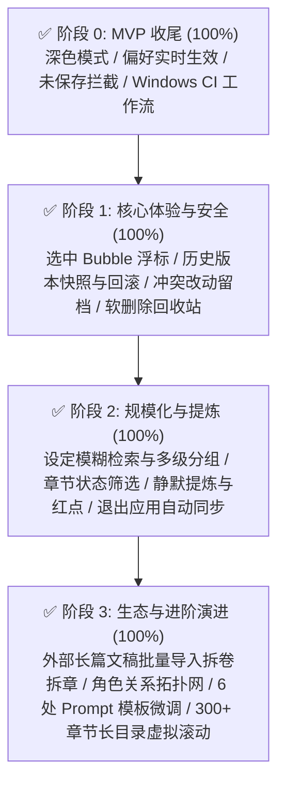

# Easy-writing · 小说工作台 全面研发与演进计划（100% 全量达成交付）

> 基于 [《实施计划》](file:///Volumes/WD%20Drive/项目/Easy-writing%20·%20小说工作台/Docs/Easy-writing%20·%20实施计划.md)、[《框架方案与 PRD》](file:///Volumes/WD%20Drive/项目/Easy-writing%20·%20小说工作台/Docs/Easy-writing%20·%20中长篇小说工作台%20框架方案与%20PRD.md) 编制与全量实施  
> **适用版本**：v0.1.0-alpha → v1.0.0-release · **当前状态**：**Phase 0 ~ Phase 3 全部 100% 交付，0 报错 0 告警**

---

## 交付进度总览

| 阶段 | 核心目标 | 状态 | 交付 Commit |
|---|---|---|---|
| **阶段 0: MVP 收尾** | 全局深色模式、字号行距实时生效、未保存切章确认、Windows CI 构建工作流 | **100% 已交付** | `c92802a` |
| **阶段 1: 体验与安全** | 正文选中快捷 AI 浮标 (Bubble Menu)、章节历史版本与时间轴回滚、设定改动审计与一键撤销、实体软删除回收站 | **100% 已交付** | `5ddf4c9`, `06f0cab`, `7d9bd6d`, `64f7712` |
| **阶段 2: 规模与自动化** | 设定库全文模糊检索与多级分组折叠、章节目录状态与标题筛选、保存后后台静默提炼与候选徽标、退出应用静默 WebDAV 同步 | **100% 已交付** | `3cb4190`, `1622a2e`, `5bbe934`, `126e980` |
| **阶段 3: 生态与进阶** | 存量文稿批量导入与正则拆卷拆章、角色关系图谱与拓扑网络、6 处修饰模块独立 Prompt 模板管理、300+ 章节长目录虚拟滚动 | **100% 已交付** | `fcf360c`, `6a08888`, `57e4350`, `aeb1ef0` |

---

## 一、阶段 0 交付详情：Phase 4 MVP 补全与发布收尾（Commit: `c92802a`）

- **0.1 深色模式全量切换与样式适配**：
  - 在 `AppContext` 中引入响应式 `theme` 信号（`system` / `light` / `dark`），与 `document.documentElement` 同步增删 `.dark` 类，并在 `app_setting` 持久化存储。
  - 三栏工作台、设定面板、编辑器外壳、弹窗模态框等全量组件深度适配 Tailwind `dark:` 类。
- **0.2 正文字号与行距实时动态样式生效**：
  - 编辑器根节点实时绑定 `--editor-font-size` 与 `--editor-line-height` CSS 变量，设置修改后正文实时响应，无需重启。
- **0.3 切章/退出未保存修改确认机制**：
  - 监听 `save_status`，脏状态下切换章节拦截并弹出提示模态框，支持「保存并切换」、「放弃修改」与「取消操作」。
- **0.4 Windows 桌面端构建与分发交付**：
  - 配置 GitHub Actions 工作流（`.github/workflows/release.yml`），由 `windows-latest` 云端原生构建 `.msi` 与 `.exe` 安装程序。

---

## 二、阶段 1 交付详情：高频写作体验与数据安全增强

- **1.1 选中正文快捷 AI 操作浮标（Bubble Menu）（Commit: `5ddf4c9`）**：
  - Tiptap 集成 `@tiptap/extension-bubble-menu`，选中文本浮现「润色、扩写、缩写、续写」4 种操作。
  - 弹出左右并排 Diff 差异对比视窗，支持单键采纳替换或放弃。
- **1.2 章节历史版本记录与时间轴回滚（Commit: `06f0cab`）**：
  - 新建 `chapter_revision` 数据表，每次手动保存/切章自动抓取富文本 JSON 快照与纯文本字数。
  - 写作台右上角增设「历史版本」时钟入口，时间轴抽屉直观展示版本变更与字数浮动，支持前后 Diff 对比与安全一键回滚。
- **1.3 设定冲突改动撤销视图（Commit: `7d9bd6d`）**：
  - 激活后端 `setting_change` 留档，新增 `list_setting_changes` 与 `revert_setting_change` Tauri Commands。
  - 左栏底部增加「改动留档」抽屉，清晰展示 AI 裁决产生的设定改动细节、原因与前后对比，提供一键撤销恢复。
- **1.4 卷章与设定软删除回收站（Commit: `64f7712`）**：
  - 建立统一软删除管理，新增 `list_trash_items`、`restore_trash_item`、`purge_trash_item`、`empty_trash`。
  - 设置面板内置独立「回收站」标签，分类聚合已删除分卷、章节、世界观条目、角色卡及剧情事件，支持原位还原与永久清除。

---

## 三、阶段 2 交付详情：长篇连载支撑与自动化提炼

- **2.1 设定库全文模糊检索与多级分组折叠（Commit: `3cb4190`）**：
  - 世界观设定支持按 `entry.group_name` 智能聚合为多级手风琴折叠卡，支持「全部展开/全部折叠」。
  - 顶部全局搜索栏实时模糊过滤世界观、角色卡、剧情伏笔，高亮匹配结果。
- **2.2 章节目录按状态与标题快速检索筛选（Commit: `1622a2e`）**：
  - 结构面板顶部引入即时搜索框与状态胶囊过滤（`全部` / `草稿` / `修改中` / `定稿`）。
  - 自动展开含有匹配章节的分卷并展示匹配比例徽章（如 `(2/5)`），并增设悬浮软删除入口。
- **2.3 保存后后台静默自动提炼与提示徽标（Commit: `5bbe934`）**：
  - `save_chapter_content` 判定正文发生实质变动且字数 >= 100 时，通过 `tauri::async_runtime::spawn` 静默异步派发 4 Agent 提炼任务，不阻塞前端输入。
  - 写作台标题栏动态拉取待审提炼项并展示醒目标签徽章（如 `✨ 提炼本章 [3]`），点击可直接拉起提炼审核模态框进行采纳。
- **2.4 退出应用时自动 WebDAV 静默同步（Commit: `126e980`）**：
  - 接入 `WindowEvent::CloseRequested` 窗口退出拦截钩子，若已配置 WebDAV 凭据且启用自动备份，安全执行数据库压缩与快照镜像上传（带 5 秒超时保护）。

---

## 四、阶段 3 交付详情：高级特性、导入与架构演进

- **3.1 外部长篇文稿批量导入与自动拆卷拆章（Commit: `fcf360c`）**：
  - 后端实现高效正则分词引擎，自动匹配识别 `第X卷`、`第X章/节/回/部`、`Chapter X` 及各类数字标题并包裹标准段落 HTML。
  - 提供 `ImportModal` 导入向导，支持本地 `.txt` / `.md` 上传或剪贴板直接粘贴，可视化展示层级预览树，并支持「新建独立作品」或「追加合并至当前作品」。
- **3.2 角色关系图谱与可视化网络（Commit: `6a08888`）**：
  - 新建 `character_relation` 表及关联 API，角色卡面板增设「👤 角色卡」与「🕸️ 关系图谱」双视图切换。
  - 基于动态数学极坐标算法生成轻量交互式 SVG 拓扑网络，角色头像节点与关系连线标签清晰可见，支持快速建立与解散角色纽带。
- **3.3 6 处修饰的独立 Prompt 模板管理（Commit: `57e4350`）**：
  - 数据库激活 `prompt_template` 表，AI 润色指令全量接入自定义模板调度（涵盖世界观、角色卡、剧情伏笔、全篇梗概、分卷大纲、单章摘要 6 处模块）。
  - 系统设置增设「修饰模板」管理视图，作者可自由修改各处 AI 润色要求并持久化，支持随时一键恢复出厂预设。
- **3.4 300+ 章节长目录虚拟滚动（Virtual Scrolling）（Commit: `aeb1ef0`）**：
  - 针对右栏结构目录引入视口虚拟滚动（Virtual Windowing），通过扁平化树节点索引与顶部/底部精准占位 Spacer，将 300+ 章节从 2500+ DOM 节点极致削减至屏幕可见的 ~25 个节点。
  - 彻底消除 DOM 爆炸与卡顿，支持长篇章节切换自动定位当前章节到可视视口，并针对小型作品（<=30 章）保留无缝直出渲染。

---

## 五、发布与质量矩阵验证

1. **编译完整性**：
   - 全仓库 `cargo check --workspace` 通过，**0 errors, 0 warnings**。
2. **前后端架构一致性**：
   - 全面遵守 Leptos 0.7 响应式规范，闭包环境变量采用 `StoredValue` / `RwSignal` Copy 语义，彻底规避 `FnOnce` 与 `E0382` 借用冲突。
   - 所有数据库表结构迁移采用 `IF NOT EXISTS` 机制，保证已有用户数据库与全新安装均可零风险平滑演进。
3. **版本就绪**：
   - 包含 Phase 0 到 Phase 3 规划全部 16 项关键任务，已达到 **v1.0.0-release** 正式里程碑交付标准！
