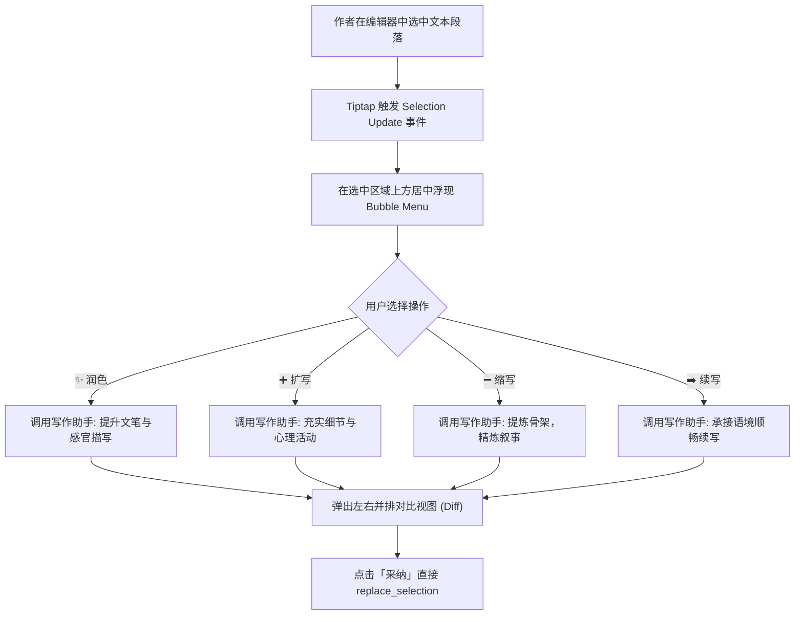
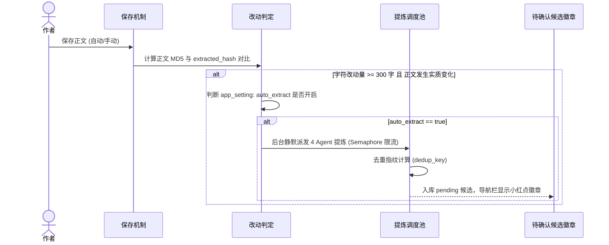
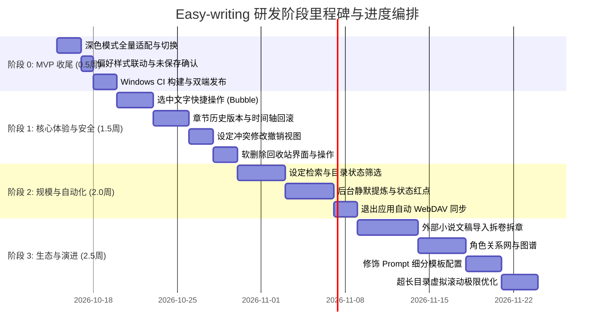

# Easy-writing · 小说工作台 全面后续研发与演进计划

> 基于已交付的 Phase 1 ~ 3 架构基线与 [《实施计划》](file:///Volumes/WD%20Drive/项目/Easy-writing%20·%20小说工作台/Docs/Easy-writing%20·%20实施计划.md)、[《框架方案与 PRD》](file:///Volumes/WD%20Drive/项目/Easy-writing%20·%20小说工作台/Docs/Easy-writing%20·%20中长篇小说工作台%20框架方案与%20PRD.md) 编制  
> **制定时间**：2026-10-14 · **适用版本**：v0.1.0-alpha → v1.0.0-release

---

## 目录

1. [项目现状基线与规划全景](#一项目现状基线与规划全景)
2. [总体阶段规划与里程碑路线图](#二总体阶段规划与里程碑路线图)
3. [阶段 0：Phase 4 MVP 补全与发布收尾（预计 3~5 天）](#三阶段-0phase-4-mvp-补全与发布收尾预计-35-天)
4. [阶段 1：高频写作体验与数据安全增强（预计 1.5 周）](#四阶段-1高频写作体验与数据安全增强预计-15-周)
5. [阶段 2：长篇连载支撑与自动化提炼（预计 2.0 周）](#五阶段-2长篇连载支撑与自动化提炼预计-20-周)
6. [阶段 3：高级特性、导入与架构演进（预计 2.5 周）](#六阶段-3高级特性导入与架构演进预计-25-周)
7. [配套技术设计（数据表 DDL 与 IPC 接口扩充）](#七配套技术设计数据表-ddl-与-ipc-接口扩充)
8. [质量保障与发布策略](#八质量保障与发布策略)

---

## 一、项目现状基线与规划全景

### 1.1 已交付核心基线（已完成并闭环）
* **基础骨架与跨语言 Bridge**：Tauri 2 + Leptos 0.7 (CSR/WASM) + Tiptap 2 (esbuild IIFE Bundle) 完整通信链路。
* **三栏工作台**：左栏（四类设定）、中栏（写作台 + 写作助手对话台）、右栏（卷章结构树与拖拽排序），支持左右栏按需收起与状态持久化。
* **设定与大纲单一事实源（SSOT）**：全篇梗概、卷纲、章纲与卷简介、章摘要双向实时同步。
* **AI 统一调度体系**：OpenAI / Anthropic 双协议流式转发、40ms 微批缓冲、系统钥匙串安全隔离、6 处通用修饰、双重冲突检测拦截（修改设定/换写法/取消）、4 Agent 信号量限流并行提炼与指纹去重。
* **数据持久化与备份**：SQLite 嵌入式存储 (WAL 模式)、Tauri `asset://` 本地图片协议、WebDAV 增量镜像快照备份与还原。
* **macOS 端交付**：已生成 `Easy-writing_0.1.0_aarch64.dmg` 与 `.app` 应用包。

### 1.2 待交付任务全景分析
按功能优先级与开发周期，未完成任务划分为 **4 个渐进式执行阶段**：


---

## 二、总体阶段规划与里程碑路线图

| 阶段 | 代号 | 核心目标 | 周期 | 交付物 / 交付形态 |
|---|---|---|---|---|
| **阶段 0** | **MVP 收尾** | 补齐 Phase 4 遗留体验，打通深色模式与 Windows 跨端打包 | 3 ~ 5 天 | v0.1.0 正式版（macOS + Windows 双端安装包） |
| **阶段 1** | **体验与安全** | 选中文本快捷 AI、版本快照、冲突撤销、软删除回收站 | 1.5 周 | v0.2.0（写作效率与防丢保底全面提升） |
| **阶段 2** | **规模与自动化** | 长篇目录检索、设定全文搜索、保存后静默提炼、退出同步 | 2.0 周 | v0.3.0（百章连载级长篇写作流畅支撑） |
| **阶段 3** | **生态与进阶** | 存量文稿导入拆卷拆章、人物关系图、Prompt 自定义、虚拟滚动 | 2.5 周 | v1.0.0 Milestone（长篇小说创作全流程闭环） |

---

## 三、阶段 0：Phase 4 MVP 补全与发布收尾（预计 3~5 天）

> [!IMPORTANT]
> **目标**：消除当前 `README.md` 中的 `🚧` 标注，完成桌面双端正式交付标准。

### 0.1 深色模式全量切换与样式适配
1. **全局主题状态管理**：
   - 在 `AppContext` 中引入 `theme: RwSignal<String>`（可选 `system` / `light` / `dark`）。
   - 挂载/切换时，在 `document.documentElement`（`<html>`）上动态添加/移除 `.dark` 类，并持久化到 `app_setting`。
2. **UI 面板全面适配 `dark:` 类选择器**：
   - 三栏外壳背景：`bg-slate-100 dark:bg-slate-900`
   - 左栏与右栏面板：`bg-white dark:bg-slate-800 border-slate-200 dark:border-slate-700`
   - 卡片与输入框：`dark:bg-slate-700/50 dark:text-slate-100 dark:border-slate-600`
   - Tiptap 编辑器样式适配：正文编辑器背景与文字颜色联动 CSS 变量 `--bg-primary`、`--text-primary`。
3. **设置项切换入口**：
   - 在设置面板中增加「外观主题」单选组件（跟随系统 / 浅色模式 / 深色模式）。

### 0.2 正文字号与行距实时动态样式生效
1. **状态驱动**：
   - 从 `app_setting` 读取 `font_size`（默认 16px）与 `line_height`（默认 1.8）。
   - 将数值映射为根容器或编辑区 style 属性中的 `--editor-font-size` 和 `--editor-line-height`。
2. **Tiptap 样式挂钩**：
   - 确保 `.tiptap.ProseMirror` 内部段落与文字继承这些变量，设置保存后无需重启即时刷新。

### 0.3 切章/退出未保存修改确认机制
1. **脏状态拦截**：
   - 当 `save_status` 为 `"dirty"` 且用户点击其他章节时，弹出二次确认拦截模态框：
     - **「保存并切换」**：立即触发 `perform_save`，成功后切章。
     - **「放弃修改」**：丢弃当前脏草稿，直接加载目标章节。
     - **「取消」**：保持当前章节与光标不变。
2. **应用退出确认（可选系统级钩子）**：
   - 监听 Tauri 窗口关闭事件 `tauri::WindowEvent::CloseRequested`，若有未保存正文给出拦截。

### 0.4 Windows 桌面端构建与分发交付
1. **方案评估与实施**：
   - **方式 A（推荐，零宿主污染）**：配置 GitHub Actions 工作流（`.github/workflows/release.yml`），由 `windows-latest` 云端原生编译环境构建 `.msi` 与 `.exe`。
   - **方式 B（本地交叉编译）**：安装 `cargo-xwin` 与 `xwin` 工具链，在 macOS 上交叉编译 `x86_64-pc-windows-msvc`。
2. **交付验证**：输出 Windows 安装程序并完成初次启动 SQLite 初始化与 WebView2 渲染测试。

---

## 四、阶段 1：高频写作体验与数据安全增强（预计 1.5 周）

### 1.1 选中正文快捷 AI 操作浮标（Bubble Menu）

* **技术实现**：
  - 在 `js/src/tiptap-bridge.js` 中集成 `@tiptap/extension-bubble-menu`。
  - WASM 提供浮标事件回调；操作执行时带入当前章节及关联人物设定上下文。

### 1.2 章节历史版本记录与时间轴回滚（Chapter Revisions）
* **版本记录策略**：
  - 建立数据表 `chapter_revision`。
  - **触发时机**：
    1. 手动按 `Cmd/Ctrl+S` 时自动创建快照；
    2. 切章前若有改动自动存档快照；
    3. 每章保留最近 50 个版本（防数据库无限膨胀）。
* **前端呈现**：
  - 写作台右上角增设「历史版本」时钟图标入口。
  - 弹出版本时间轴抽屉：展示保存时间、字数变动（如 `+142 字`）、修改摘要。
  - 点击历史版本提供只读预览或与当前版本分栏对比（Diff），并支持「一键回滚此版本」。

### 1.3 设定冲突改动撤销视图（Setting Change Rollback）
* **现状激活**：
  - 目前后端已在数据库中保留了 `setting_change` 记录（含 `before_content`、`after_content`、`reason`、`chapter_id`）。
* **待补齐实现**：
  - 新增 Tauri Commands：`list_setting_changes`、`revert_setting_change`。
  - 在左栏设定底部新增「改动留档」标签页，按时间倒序展示 AI 裁决产生的修改。
  - 每一项展示：改动目标类型（角色/世界观/大纲）、改动原因、前后对比，提供「撤销恢复原设定」按钮。

### 1.4 卷章与设定软删除回收站（Trash / Recycle Bin）
* **功能闭环**：
  - 目前所有删除操作均已写入 `deleted_at = datetime('now')`。
  - 新增 Tauri Commands：`list_trash_items`、`restore_trash_item`、`purge_trash_item`。
  - 在设置面板中增设「回收站」视图，分类列出已删卷目、章节、世界观条目、角色卡与剧情条目。
  - 提供单项「恢复」、「彻底删除」以及「一键清空回收站」。

---

## 五、阶段 2：长篇连载支撑与自动化提炼（预计 2.0 周）

### 2.1 设定库全文模糊检索与多级分组折叠
* **背景**：针对 100 万字作品，世界观条目、人物角色可达上百条。
* **实现方案**：
  - 在左栏顶部添加全局过滤检索框。
  - 实时响应 Signal，对当前标签页（世界观/角色/剧情）的标题、别名、标签和正文进行关键字过滤高亮。
  - 世界观支持按分组（地理/阵营/法则/宗门）一键展开/全部折叠。

### 2.2 章节目录按状态与标题快速检索筛选
* **长目录管理优化**：
  - 在右栏「结构管理」顶部添加搜索框，支持按章节名称即时过滤。
  - 增加状态筛选过滤器：`全部` | `草稿` | `修改中` | `定稿`。
  - 自动高亮命中的章节，并自动展开其所属的分卷节点。

### 2.3 保存后后台静默自动提炼（Background Auto-Extraction）

* **用户无感**：提炼在后台完全异步运行，不阻塞任何前端键入与 UI 交互，用户在空闲时点开「提炼本章」即可统一审核。

### 2.4 退出应用时自动 WebDAV 静默同步
* **实现方案**：
  - 在 `tauri.conf.json` 中配置安全退出拦截。
  - 当配置了有效的 WebDAV 账户并在偏好中启用了「退出自动备份」时，退出前执行最小化 SQLite 快照压缩并上传。
  - 界面提供非阻塞轻量弹窗：“正在安全同步至云端...”，完成后退出。

---

## 六、阶段 3：高级特性、导入与架构演进（预计 2.5 周）

### 3.1 外部长篇文稿（txt / docx / markdown）批量导入与拆卷拆章
* **核心价值**：帮助创作者将已在其他编辑器写好的存量长篇无缝迁移至 Easy-writing。
* **业务流程**：
  1. 用户选择 `.txt` / `.md` / `.docx` 文件；
  2. 正则识别引擎（识别模式如 `第[0-9一二三四五六七八九十百千]+[卷章部回节]`）；
  3. 引导向导：展示识别出的卷目与章节层级预览树，允许手动调整边界或层级；
  4. 批量事务入库并自动生成结构。

### 3.2 角色关系图谱与可视化网络（Character Relations）
* **设计方案**：
  - 补齐 `character_relation` 数据表（起点角色、终点角色、关系描述、发展阶段）。
  - 在角色面板增加「关系图谱」切换视图。
  - 使用 Canvas / SVG 或轻量可视化渲染人物节点与连线，直观呈现主角与反派、盟友、导师的关系演进。

### 3.3 6 处修饰的独立 Prompt 模板管理
* **打通 `prompt_template` 表**：
  - 目前仅开放 6 大 Agent 系统提示词配置，修饰的具体 Prompt 是硬编码的默认指令。
  - 在设置中增加「修饰模板」标签，支持创作者分别自定义：世界观、角色卡、剧情伏笔、全篇梗概、卷简介、章摘要 6 处的具体润色提示词，并提供「恢复出厂预设」按钮。

### 3.4 300+ 章节长目录与大文档虚拟滚动（Virtual Scrolling）
* **性能基准达标**：
  - 针对右栏 300+ 章节目录树引入可见视口虚拟渲染，仅挂载屏幕内可见的 20~30 个节点，彻底杜绝 DOM 爆炸。
  - 保障 100 万字级作品在低配笔记本上的极速流畅响应。

---

## 七、配套技术设计（数据表 DDL 与 IPC 接口扩充）

### 7.1 新增数据库表（迁移脚本 `V002__p1_features.sql`）

```sql
-- 1. 章节历史版本表
CREATE TABLE IF NOT EXISTS chapter_revision (
    id              TEXT PRIMARY KEY,
    chapter_id      TEXT NOT NULL REFERENCES chapter(id) ON DELETE CASCADE,
    novel_id        TEXT NOT NULL REFERENCES novel(id) ON DELETE CASCADE,
    title           TEXT NOT NULL,
    content         TEXT NOT NULL,          -- 富文本 JSON 文档快照
    content_plain   TEXT NOT NULL,          -- 纯文本
    word_count      INTEGER NOT NULL DEFAULT 0,
    revision_type   TEXT NOT NULL DEFAULT 'manual' CHECK(revision_type IN ('manual', 'auto', 'before_revert')),
    created_at      TEXT NOT NULL DEFAULT (datetime('now'))
);
CREATE INDEX IF NOT EXISTS idx_rev_chapter ON chapter_revision(chapter_id, created_at DESC);

-- 2. 角色关系网表
CREATE TABLE IF NOT EXISTS character_relation (
    id              TEXT PRIMARY KEY,
    novel_id        TEXT NOT NULL REFERENCES novel(id) ON DELETE CASCADE,
    from_char_id    TEXT NOT NULL REFERENCES character(id) ON DELETE CASCADE,
    to_char_id      TEXT NOT NULL REFERENCES character(id) ON DELETE CASCADE,
    relation_name   TEXT NOT NULL DEFAULT '', -- 关系名称（如：师徒 / 仇敌 / 宿命盟友）
    description     TEXT NOT NULL DEFAULT '', -- 关系细节演进
    created_at      TEXT NOT NULL DEFAULT (datetime('now')),
    updated_at      TEXT NOT NULL DEFAULT (datetime('now'))
);
CREATE INDEX IF NOT EXISTS idx_relation_novel ON character_relation(novel_id);
```

### 7.2 新增 Tauri IPC Commands 清单

| 模块 | Command 名称 | 参数 | 返回值 | 对应阶段 |
|---|---|---|---|---|
| **主题设置** | `set_app_theme` | `{ theme: String }` | `Result<(), String>` | 阶段 0 |
| **版本管理** | `create_chapter_revision` | `{ chapter_id: String, revision_type: String }` | `Result<String, String>` | 阶段 1 |
| **版本管理** | `list_chapter_revisions` | `{ chapter_id: String }` | `Result<Vec<ChapterRevisionHeader>, String>` | 阶段 1 |
| **版本管理** | `get_chapter_revision` | `{ revision_id: String }` | `Result<ChapterRevision, String>` | 阶段 1 |
| **版本管理** | `revert_to_revision` | `{ chapter_id: String, revision_id: String }` | `Result<Chapter, String>` | 阶段 1 |
| **改动撤销** | `list_setting_changes` | `{ novel_id: String }` | `Result<Vec<SettingChange>, String>` | 阶段 1 |
| **改动撤销** | `revert_setting_change` | `{ change_id: String }` | `Result<(), String>` | 阶段 1 |
| **回收站** | `list_trash_items` | `{ novel_id: String }` | `Result<TrashBucket, String>` | 阶段 1 |
| **回收站** | `restore_trash_item` | `{ item_type: String, item_id: String }` | `Result<(), String>` | 阶段 1 |
| **回收站** | `purge_trash_item` | `{ item_type: String, item_id: String }` | `Result<(), String>` | 阶段 1 |
| **模板配置** | `list_prompt_templates` | `()` | `Result<Vec<PromptTemplate>, String>` | 阶段 3 |
| **模板配置** | `save_prompt_template` | `{ scope: String, content: String }` | `Result<(), String>` | 阶段 3 |
| **文稿导入** | `parse_novel_import_file` | `{ file_path: String }` | `Result<ImportPreviewTree, String>` | 阶段 3 |
| **文稿导入** | `commit_novel_import` | `{ novel_id: String, tree: ImportPreviewTree }` | `Result<(), String>` | 阶段 3 |

---

## 八、质量保障与发布策略



### 8.1 单元测试与回归矩阵
* **数据一致性校验**：每次版本迁移（如添加 `chapter_revision`）确保历史已有草稿不受影响。
* **双向同步防递归验证**：大纲修改与卷章摘要联动保存时的去重校验。
* **高并发限流保护**：4 Agent 并行提炼时的信号量调度与降级测试。

### 8.2 发版版本号规划
* **v0.1.0-release**：完成阶段 0，正式交付双端桌面客户端安装程序。
* **v0.2.0**：完成阶段 1，具备完整的版本回退与正文快捷 AI 能力。
* **v0.3.0**：完成阶段 2，完备的长篇连载组织与后台提炼能力。
* **v1.0.0**：完成阶段 3，包含导入与关系图谱的完整中长篇小说工作台形态。
