# Easy-writing · 文档体系索引与全景导航

欢迎查阅 Easy-writing（中长篇小说工作台）项目文档库。本文档为 `Docs/` 目录的总索引，厘清各项设计方案、演进报告、重构记录与工程规范的生命周期与相互关系。

---

## 一、 文档体系全景图

```mermaid
flowchart TD
    Docs["Docs 核心文档库"]

    Docs --> Baselines["🏛️ 产品与架构基线 (Archived)"]
    Docs --> Milestones["🔬 专项重构与演进报告"]
    Docs --> Remediation["🛡️ 质量审校与整改方案"]
    Docs --> Operations["🛠️ 工程协作与发布规范"]

    Baselines --> B1["《框架方案与 PRD》<br>产品定位、三栏设计、多 Agent 范式"]
    Baselines --> B2["《实施计划》<br>工程选型、初始 DDL、流水线基线"]
    Baselines --> B3["《全面后续研发与演进计划》<br>Phase 0~3 基础功能交付矩阵"]

    Milestones --> M1["《设计文档与代码差异核对报告》<br>v0.2.0 差异复核与补齐"]
    Milestones --> M2["《代码优化实施与量测报告》<br>IPC 构建器重构、参数结构体精简"]
    Milestones --> M3["《遗留命令处置与图库UI实施方案》<br>后端命令清点、资产图库建设"]
    Milestones --> M4["《不足修正方案与验证门》<br>Tiptap 钉版、CI 护栏、版本阶梯"]
    Milestones --> M5["《作品导入优化与AI全域提炼升级报告》<br>EPUB/TXT 导入解耦、6 层自愈提炼"]

    Remediation --> R1["《Easy-writing 审校报告 2026-10-18》<br>外部高水准第三方系统审校意见"]
    Remediation --> R2["《Easy-writing 审校整改方案》<br>P0~P2 13项缺陷彻底修复与回归验证"]
    Remediation --> R3["《Easy-writing 审校报告-第三方》<br>v0.3.5 外部静态审校评分 (7.4/10)"]
    Remediation --> R4["《第三方审校整改闭环与实施报告》<br>切章丢稿防线、AI 提炼哈希重试、CSP 安全"]
    Remediation --> R5["《Easy-writing 审校报告-第三方 02》<br>v0.3.6 二轮审校：AI 提炼全链路、切章异步锁、Win Release"]

    Operations --> O1["《提交流程》<br>GitHub / CNB 双远程与隔离 worktree"]
    Operations --> O2["《双远程发布流程》<br>版本晋级、多端构建、双平台 Release SOP"]
```



---

## 二、 文档清单与速查矩阵

| 文档名称 | 类型与生命周期 | 适用版本 / 基线 | 核心内容与关注点 | 关联代码模块 |
|---|:---:|:---:|---|---|
| [**框架方案与 PRD**](file:///Volumes/WD%20Drive/项目/Easy-writing%20·%20小说工作台/Docs/Easy-writing%20·%20中长篇小说工作台%20框架方案与%20PRD.md) | 规划基线（已封存） | v0.1.0 立项基线 | 三栏工作台、左栏四类设定、右栏卷章树、写作助手严格模式、WebDAV 全库备份与图片增量机制 | `frontend/`, `src-tauri/` |
| [**实施计划**](file:///Volumes/WD%20Drive/项目/Easy-writing%20·%20小说工作台/Docs/Easy-writing%20·%20实施计划.md) | 工程基线（已封存） | v0.1.0 架构基线 | Tauri 2 + Leptos 0.7 + Tiptap 2 技术选型、初始 DDL、4 阶段排期与时序图 | `Cargo.toml`, `src-tauri/migrations/` |
| [**全面后续研发与演进计划**](file:///Volumes/WD%20Drive/项目/Easy-writing%20·%20小说工作台/Docs/Easy-writing%20·%20小说工作台%20全面后续研发与演进计划.md) | 里程碑记录（已封存） | Phase 0 ~ Phase 3 | 深色模式、Bubble 菜单、章节快照、设定改动留档、虚拟滚动（`volume_list.rs`）、Canvas 2D 力导向图谱 | `frontend/src/components/` |
| [**设计文档与代码差异核对报告**](file:///Volumes/WD%20Drive/项目/Easy-writing%20·%20小说工作台/Docs/设计文档与实际代码差异核对报告.md) | 专项核对与修复报告 | v0.2.0 | 梳理 PRD 与真实代码差异，修复 `restore.rs` 补图列名、对话记录落库与模型拉取 | `src-tauri/src/sync/restore.rs`, `db/chat.rs` |
| [**代码优化实施与量测报告**](file:///Volumes/WD%20Drive/项目/Easy-writing%20·%20小说工作台/Docs/代码优化实施与量测报告.md) | 架构重构量测 | v0.2.0 → v0.3.0 | 废除 79 个 IPC 参数结构体改用链式构建器、db mapper 集中消重、测试覆盖补齐 | `frontend/src/tauri_api/`, `src-tauri/src/db/` |
| [**遗留命令处置与图库UI实施方案**](file:///Volumes/WD%20Drive/项目/Easy-writing%20·%20小说工作台/Docs/遗留命令处置与图库UI实施方案.md) | 特性建设报告 | v0.3.0 | 88 个后端命令对账、删除死命令、建立命令预留机制、落地资产图库 UI 与孤立图片对账 | `frontend/src/components/editor/asset_gallery.rs` |
| [**修正方案 · 不足补齐与验证门**](file:///Volumes/WD%20Drive/项目/Easy-writing%20·%20小说工作台/Docs/修正方案%20·%20不足补齐与验证门.md) | 质量与护栏方案 | v0.3.0 → v0.3.3 | 消除 Tiptap 双实例错配（钉死 v2）、建立 GitHub Actions CI、保存状态机消除竞态、V002 迁移阶梯 | `package.json`, `.github/workflows/ci.yml` |
| [**作品导入优化与AI全域提炼升级报告**](file:///Volumes/WD%20Drive/项目/Easy-writing%20·%20小说工作台/Docs/作品导入优化与AI全域提炼自修复升级报告.md) | 核心特性升级 | v0.3.3 → v0.3.4 | 导入引擎解耦（common/text/epub/db）、分卷手风琴与即时更名、6 层自修复提炼、全域八大实体联动 | `src-tauri/src/import/`, `src-tauri/src/agent/` |
| [**Easy-writing 审校报告 2026-10-18**](file:///Volumes/WD%20Drive/项目/Easy-writing%20·%20小说工作台/Docs/Easy-writing%20审校报告%202026-10-18.md) | 外部审计原始文档 | 2026-10-18 | 外部专家对仓库 README 与实施计划深度审校提出的 13 条意见（含 5 项致命设计隐患） | 全项目 |
| [**Easy-writing 审校整改方案**](file:///Volumes/WD%20Drive/项目/Easy-writing%20·%20小说工作台/Docs/Easy-writing%20审校整改方案.md) | 整改与验收结论 | v0.3.4 (100% 达标) | 逐一攻克切章竞态、提炼更新误杀、WebDAV 恢复保护、图片相对协议、原子上传等 13 项隐患 | `app_shell.rs`, `extraction.rs`, `restore.rs` |
| [**Easy-writing 审校报告-第三方**](file:///Volumes/WD%20Drive/项目/Easy-writing%20·%20小说工作台/Docs/Easy-writing%20审校报告-第三方.md) | 外部静态审校报告 | v0.3.5 (7.4 / 10) | 外部专家对 v0.3.5 源码静态审校，指出切章丢稿控制流漏洞、AI 提炼哈希锁死、CSP 缺失等要害 | `frontend/`, `src-tauri/` |
| [**第三方审校整改闭环与实施报告**](file:///Volumes/WD%20Drive/项目/Easy-writing%20·%20小说工作台/Docs/Easy-writing%20审校整改闭环方案与实施报告-第三方反馈.md) | 专项重构与防御闭环 | v0.3.5 (100% 修复) | SaveOutcome 状态机、非 saved 切章全拦截、AI 提炼哈希重试、章节梗概去重、远程 HTTPS 门禁与 CSP | `save_state.rs`, `extraction.rs`, `gateway.rs` |
| [**Easy-writing 审校报告-第三方 02**](file:///Volumes/WD%20Drive/项目/Easy-writing%20·%20小说工作台/Docs/Easy-writing%20审校报告-第三方%2002.md) | 外部二轮审校报告 | v0.3.6 | 外部对 v0.3.6 交付审校：AI 提炼全链路保护、切章异步锁、Windows Release 测试失败、删除数据库检查 | `extraction.rs`, `chapter_list.rs`, `package.json` |
| [**提交流程**](file:///Volumes/WD%20Drive/项目/Easy-writing%20·%20小说工作台/Docs/提交流程.md) | 协作运维规范 | 日常开发规范 | GitHub 主目录提交与 CNB `.cnb-worktree` 提交身份隔离、cherry-pick 重放流程 | `.git/worktrees/` |
| [**双远程发布流程**](file:///Volumes/WD%20Drive/项目/Easy-writing%20·%20小说工作台/Docs/双远程发布流程.md) | 版本发布 SOP | 发版运维规范 | 版本号 5 处晋级、自动化测试、桌面端打包、双端代码与 Tag 推送、GitHub & CNB 双端 Release 挂载 | `release-packages/` |

---

## 三、 版本演进与文档脉络

```
立项初期 (2026-10-14)
   ├─ 《框架方案与 PRD》 ─────────── 确立单机、三栏、多 Agent、设定自生长核心范式
   └─ 《实施计划》 ───────────────── 确定 Tauri 2 + Leptos 0.7 + Tiptap 2 技术栈与初始基线

功能交付阶段 (2026-10-14 ~ 15)
   ├─ 《全面后续研发与演进计划》 ── 记录 Phase 0~3 基础功能交付
   └─ 《设计文档与实际代码差异报告》─ 消除文档宣称与代码实现的空洞，补齐对话与模型拉取

架构重构与特性落地 (2026-10-16)
   ├─ 《代码优化实施与量测报告》 ── 删除 79 个 IPC 结构体，统一 invoke 构建器
   ├─ 《遗留命令处置与图库UI方案》 ─ 梳理 88 命令，落地资产图库与对账
   ├─ 《提交流程》 ──────────────── 规范 GitHub 与 CNB 双远程独立身份与 worktree
   └─ 《双远程发布流程》 ────────── 规范跨平台桌面应用 Release 发布 SOP

深度稳定性与能力扩展 (2026-10-17)
   ├─ 《不足修正方案与验证门》 ──── 钉死 Tiptap v2 单一实例，建立 CI 与保存状态机
   └─ 《作品导入优化与提炼升级》 ── 解耦导入引擎，落地 EPUB 导入与 6 层自愈 AI 提炼

安全加固与全系统验收 (2026-10-18)
   ├─ 《Easy-writing 审校报告》 ─── 历史高水准系统审校意见
   ├─ 《Easy-writing 审校整改方案》─ 13 项缺陷 100% 修复（切章 await、WebDAV 安全门、图片相对协议）
   ├─ 《Easy-writing 审校报告-第三方》 ─ 外部静态代码审校（7.4分，深挖切章丢稿控制流）
   ├─ 《第三方审校整改闭环与实施报告》 ─ P0 切章丢稿状态机、AI 哈希重试、CSP 安全全面闭环
   ├─ 《Easy-writing 审校报告-第三方 02》 ─ 二轮审校整改（AI 提炼全链路保护、切章异步锁、Win Release 修复）
   └─ 《CHANGELOG.md》 ──────────── 设立变更日志跟踪基线与质量加固记录
```

---

## 四、 文档维护与协同规范

为杜绝“文档滞后于代码”、“文档彼此矛盾”与“跨平台不兼容”问题，请遵守以下维护准则：

1. **跨平台兼容与命名规范**：
   - 严禁在文件名中使用冒号（`:`）、反斜杠（`\`）等 Windows 文件系统非法字符（如原审校报告文件名中冒号已被修正为连字符 `2026-10-18`）；
   - 文件统一采用 UTF-8 编码与 LF 换行符。
2. **敏感信息脱敏保护**：
   - 文档与示例命令中严禁出现个人真实邮箱（如 QQ、163 等），统一脱敏为 `user@example.com` 或 `developer`；
   - 严禁在文档中硬编码 API Token、WebDAV 密码等凭据。
3. **基线封存与增量原则**：
   - 初始立项方案（如 PRD 与《实施计划》）作为**设计基线**予以标注封存，不再对历史正文进行频繁改写；
   - 实际特性的增删与重构统一记录于根目录 [CHANGELOG.md](file:///Volumes/WD%20Drive/项目/Easy-writing%20·%20小说工作台/CHANGELOG.md)；有重大技术攻关时编写专项技术实施报告。
4. **代码与文档事实同步**：
   - 数据库 Schema 演进必须与 `src-tauri/migrations/` 迁移脚本一一对应；
   - IPC 命令变动必须同步 `tests/command_key_sweep.rs` 与 `tests/ipc_argcase.rs`；
   - 文档宣称的性能指标必须附带真实数据或复现条件（如“274 万字《绍宋》473 章实测”）。
