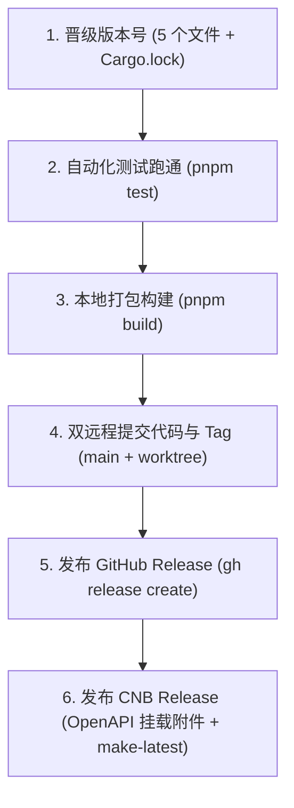

# Easy-writing · 双远程 Release 发布流程参考规范

> 制定日期：2026-10-16
> 适用版本：v0.3.0+
> 适用场景：新功能/修复版本发布、版本号晋级、安装包重新构建与 GitHub + CNB 双平台 Release 同步发布。

---

## 一、双远程平台架构与发布机制

本项目采用 GitHub（国际主仓）与 CNB（国内镜像）双远程协同架构：

| 平台 | 仓库地址 | 代码提交身份 | Release 发布通道 |
|---|---|---|---|
| **GitHub** | `git@github.com:orderye/Easy-writing.git` | `user@example.com`（主目录） | `gh release create` / GitHub Actions |
| **CNB** | `https://cnb.cool/toroyxxx/Easy-writing.git` | `...@noreply.cnb.cool`（`.cnb-worktree`） | CNB OpenAPI / `@cnbcool/cnb-cli` |

> ⚠️ **核心原则**：
> 1. **代码提交身份严格隔离**：GitHub 在主目录提交，CNB 必须在 `.cnb-worktree` 用 `cherry-pick --no-commit` 重新生成带 CNB 邮箱的 commit（详见 [提交流程](file:///Volumes/WD%20Drive/项目/Easy-writing%20·%20小说工作台/Docs/submission-process.md)）。
> 2. **Release 必须双端独立挂载**：GitHub 具备原生 Actions 与 `gh` CLI，CNB 需通过其专用 OpenAPI / CLI 挂载 DMG 与 ZIP 附件并标记为 `latest`。

---

## 二、标准发布 6 步 SOP



---

### 第一步：版本号晋级（Version Bump）

按语义化版本（SemVer）规则将全 Workspace 同步升级（如 `0.3.0` → `0.3.1`）：

1. **同步修改 5 处版本号**：
   - `package.json`：`"version": "0.3.1"`
   - `src-tauri/tauri.conf.json`：`"version": "0.3.1"`
   - `src-tauri/Cargo.toml`：`version = "0.3.1"`
   - `frontend/Cargo.toml`：`version = "0.3.1"`
   - `shared-types/Cargo.toml`：`version = "0.3.1"`
   *(注：前端界面文本已动态绑定 `concat!("v", env!("CARGO_PKG_VERSION"))`，无需手动改写)*

2. **锁定依赖与语法检查**：
   ```bash
   cargo check
   ```
   自动将 `Cargo.lock` 中的所有内部 Crate 版本号同步刷新。

---

### 第二步：运行全量自动化测试设施

在打包前必须保证全量测试绿灯通过，杜绝发布带有断言失败或回归缺陷的版本：

```bash
pnpm test
```

> **测试覆盖清单**：
> - `pnpm test:frontend`（`node --test tests/frontend/bundle_graph.test.js tests/frontend/gallery_and_bridge.test.js`）：涵盖缩略图 URL 解析、Tiptap 富文本图片光标插入、剪贴板写入与降级、文件缺失徽标收集响应、Tailwind 深色模式样式存在性；
> - `pnpm test:backend`（`cargo test --workspace`）：涵盖 IPC 命令自动提取比对、UI 契约测试、参数 snake_case 约定、作品回收站级联删除与存储对账测试。

---

### 第三步：桌面端原生打包（Release Build）

执行跨端正式环境编译与安装包制作：

```bash
# 1. 编译前端资源、WASM 并完成 Tauri 原生打包
pnpm build

# 2. 同步产物至 release-packages/ 并生成便携免安装 ZIP
VERSION="0.3.5"
cp "target/release/bundle/dmg/Easy-writing_${VERSION}_aarch64.dmg" release-packages/
ditto -c -k --keepParent "target/release/bundle/macos/Easy-writing.app" "release-packages/Easy-writing_${VERSION}_macos_aarch64.zip"

# 3. 清理构建可能产生的多余工作区文件
rm -f pnpm-workspace.yaml
```

产物核验：
- `release-packages/Easy-writing_X.Y.Z_aarch64.dmg`（macOS Apple Silicon 安装镜像）
- `release-packages/Easy-writing_X.Y.Z_macos_aarch64.zip`（macOS 便携免安装压缩包）

---

### 第四步：双远程提交代码与推送 Tag

#### 4.1 GitHub 端（主目录）
```bash
git add Cargo.lock frontend/Cargo.toml package.json shared-types/Cargo.toml src-tauri/Cargo.toml src-tauri/tauri.conf.json CHANGELOG.md
git commit -m "chore(release): bump version to ${VERSION} and rebuild desktop application"
git push origin main
```

#### 4.2 CNB 端（.cnb-worktree）
```bash
COMMIT_HASH=$(git rev-parse HEAD)
cd .cnb-worktree
git cherry-pick --no-commit ${COMMIT_HASH}
git commit -m "chore(release): bump version to ${VERSION} and rebuild desktop application"
git push
cd ..
```

#### 4.3 推送 Git Tag 至双远程
```bash
TAG="v${VERSION}"
git tag -a "${TAG}" -m "Release ${TAG}"
git push origin "${TAG}"
git push cnb "${TAG}"
```

---

### 第五步：发布 GitHub Release

通过 GitHub 官方 CLI 工具发布 Release 并挂载两个安装包：

```bash
gh release create "v${VERSION}" \
  "release-packages/Easy-writing_${VERSION}_aarch64.dmg#macOS aarch64 (Apple Silicon DMG)" \
  "release-packages/Easy-writing_${VERSION}_macos_aarch64.zip#macOS aarch64 (Portable Zip)" \
  --title "Easy-writing · 中长篇小说工作台 v${VERSION}" \
  --notes "### 🌟 Easy-writing v${VERSION} 发布说明

- 记录本版本更新的关键功能与修复项。"
```

---

### 第六步：发布 CNB Release 与附件挂载

CNB 平台的 Release 不会从 GitHub 自动同步，必须通过其 OpenAPI 执行完整的创建、文件二进制直传与附件挂载流程。

#### 5.1 SHA256SUMS 校验和（任务书 T13）

**GitHub 端由 CI 自动完成**：`release.yml` 的 `checksums` job 会在全部平台产物上传后，下载所有附件、生成 `SHA256SUMS.txt` 并传回 Release。只要走 tag 触发的正常发布流程，GitHub Release 必然带校验和文件。

**CNB 端需手动同步同一份文件**（在 GitHub Release 生成之后执行）：

```bash
# 1. 从 GitHub Release 下载 CI 生成的 SHA256SUMS.txt
gh release download "v${VERSION}" --dir /tmp/sums --clobber
SUMS_FILE="/tmp/sums/SHA256SUMS.txt"

# 2. 核对：CNB 上挂载的安装包与 GitHub 同源（同字节），校验和应逐行一致
shasum -a 256 release-packages/Easy-writing_${VERSION}_aarch64.dmg   # macOS
# Windows（PowerShell）: certutil -hashfile Easy-writing_0.3.8_windows_x64-setup.exe SHA256

# 3. 把 SHA256SUMS.txt 按第六步的三段式上传协议挂载到 CNB Release
#    （asset_name 用 "SHA256SUMS.txt"，与 DMG/ZIP 走同一 upload_cnb.mjs 流程）
```

应用内更新提示（设置 → 检查更新）会读取 Release 的 `SHA256SUMS.txt`，在每个安装包下方展示 SHA-256 与校验方法；作者下载后应先比对哈希再安装。应用保持「只跳转下载页、不自动安装」。

#### 5.2 构建矩阵与代码签名 secrets（任务书 T14）

**构建矩阵**：`release.yml` 现产出三平台包 —— macOS Apple Silicon（aarch64 DMG/ZIP）、macOS Intel（x86_64 DMG/ZIP）、Windows（x64）。Intel 构建与 Apple Silicon 并列在同一矩阵，产物各自独立上传。

**签名开关语义**：全部签名步骤以「secret 是否配置」为条件。未配置任何 secret 时 CI 完整跑通并产出**未签名**安装包（这是当前状态）；配置后同一次流水线自动切换为签名 + 公证产物。

**所需 secrets 清单（值由人工在仓库 Settings → Secrets and variables → Actions 配置，禁止写入代码）**：

| Secret 名 | 平台 | 用途 |
|---|---|---|
| `APPLE_CERTIFICATE` | macOS | base64 编码的 .p12 开发者证书（Developer ID Application） |
| `APPLE_CERTIFICATE_PASSWORD` | macOS | 该 .p12 的导出密码 |
| `APPLE_SIGNING_IDENTITY` | macOS | 证书名称，如 `Developer ID Application: NAME (TEAMID)` |
| `APPLE_ID` | macOS | 公证用 Apple ID 邮箱 |
| `APPLE_PASSWORD` | macOS | 公证用 app-specific password（appleid.apple.com 生成） |
| `APPLE_TEAM_ID` | macOS | 开发者团队 ID（10 位） |
| `WINDOWS_SIGNING_PFX` | Windows | base64 编码的代码签名 PFX 证书 |
| `WINDOWS_SIGNING_PFX_PASSWORD` | Windows | 该 PFX 的密码 |

**未签名包的首次打开方式**（同步写在 README「下载与安装」）：

- macOS：Gatekeeper 会拦截无开发者签名的应用。右键点击应用 →「打开」→ 再点「打开」；或在「系统设置 → 隐私与安全性」底部点「仍要打开」；命令行方式：`xattr -cr /Applications/Easy-writing.app`
- Windows：SmartScreen 提示时点「更多信息」→「仍要运行此应用」。

#### 6.1 凭据获取（免硬编码）
系统钥匙串已存储 CNB 的访问凭据，可通过 git credential 自动读取：
```bash
CNB_TOKEN=$(git credential fill <<EOF
protocol=https
host=cnb.cool
EOF
| grep '^password=' | cut -d= -f2)
```

#### 6.2 创建 CNB Release
```bash
RELEASE_RESP=$(curl -s -X POST \
  -H "Authorization: Bearer ${CNB_TOKEN}" \
  -H "Content-Type: application/json" \
  -H "Accept: application/json" \
  -d "{
    \"tag_name\": \"v${VERSION}\",
    \"name\": \"Easy-writing · 中长篇小说工作台 v${VERSION}\",
    \"body\": \"Easy-writing v${VERSION} 正式发布\",
    \"draft\": false,
    \"prerelease\": false
  }" \
  "https://api.cnb.cool/toroyxxx/Easy-writing/-/releases")

RELEASE_ID=$(echo "${RELEASE_RESP}" | jq -r '.id')
echo "CNB Release 创建成功，ID: ${RELEASE_ID}"
```

#### 6.3 上传并确认附件（DMG 与 ZIP）

CNB 采用预签名 URL 二进制流式上传模式，标准三段式协议：
1. 请求获取 `asset-upload-url` 与 `verify_url`；
2. 将文件内容以 `PUT` 直传对象存储；
3. `POST` 请求 `verify_url` 确认文件并正式挂载入 Release。

自动化 Node.js 上传脚本模板（可临时运行并清理）：
```javascript
// upload_cnb.mjs
import fs from 'node:fs';
import path from 'node:path';

const TOKEN = process.env.CNB_TOKEN;
const REPO = 'toroyxxx/Easy-writing';
const RELEASE_ID = process.env.RELEASE_ID;
const files = [
  `release-packages/Easy-writing_${process.env.VERSION}_aarch64.dmg`,
  `release-packages/Easy-writing_${process.env.VERSION}_macos_aarch64.zip`
];

for (const file of files) {
  const fileName = path.basename(file);
  const size = fs.statSync(file).size;
  console.log(`上传附件: ${fileName} (${size} bytes)...`);

  // 1. 获取上传地址
  const urlRes = await fetch(`https://api.cnb.cool/${REPO}/-/releases/${RELEASE_ID}/asset-upload-url`, {
    method: 'POST',
    headers: { 'Authorization': `Bearer ${TOKEN}`, 'Content-Type': 'application/json' },
    body: JSON.stringify({ asset_name: fileName, size, overwrite: true })
  });
  const { upload_url, verify_url } = await urlRes.json();

  // 2. PUT 直传二进制
  await fetch(upload_url, {
    method: 'PUT',
    headers: { 'Authorization': `Bearer ${TOKEN}`, 'Content-Length': String(size), 'Content-Type': 'application/octet-stream' },
    body: fs.readFileSync(file)
  });

  // 3. 确认挂载
  await fetch(verify_url, {
    method: 'POST',
    headers: { 'Authorization': `Bearer ${TOKEN}` }
  });
  console.log(`✓ 已成功挂载: ${fileName}`);
}
```

执行上传：
```bash
CNB_TOKEN="${CNB_TOKEN}" RELEASE_ID="${RELEASE_ID}" VERSION="${VERSION}" node upload_cnb.mjs
rm -f upload_cnb.mjs
```

#### 6.4 标记为最新版本（Make Latest）
```bash
CNB_TOKEN="${CNB_TOKEN}" npx --yes @cnbcool/cnb-cli releases patch-release \
  --repo "toroyxxx/Easy-writing" \
  --release-id "${RELEASE_ID}" \
  --make-latest true
```

---

## 三、发布完成核对清单（Checklist）

每次发布完毕后，请运行以下命令进行全局一致性抽检：

```bash
# 1. 校验双远程 commit 状态与作者标识
printf '%-16s %s\n' 'origin/main:' "$(git ls-remote origin main | cut -c1-7)"
printf '%-16s %s\n' 'cnb/main:'    "$(git ls-remote cnb main | cut -c1-7)"
git log -1 --format='%an <%ae> - %s' origin/main
git log -1 --format='%an <%ae> - %s' cnb/main

# 2. 校验双远程 tag 状态
git ls-remote --tags origin "v${VERSION}"
git ls-remote --tags cnb "v${VERSION}"

# 3. 校验 GitHub Release
gh release view "v${VERSION}"

# 4. 校验 CNB Latest Release
CNB_TOKEN=$(git credential fill <<EOF
protocol=https
host=cnb.cool
EOF
| grep '^password=' | cut -d= -f2)
npx --yes @cnbcool/cnb-cli releases get-latest-release --repo "toroyxxx/Easy-writing"
```

**期望验收标准**：
- [x] GitHub 与 CNB 两端分支最新 commit 内容一致，作者身份各自独立且自足；
- [x] 双端均存在对应的 `vX.Y.Z` 标签；
- [x] GitHub Release 状态为 `Latest`，挂载 `.dmg` 与 `.zip` 附件；
- [x] CNB Release `is_latest` 字段为 `true`，`assets` 列表中同时挂载 `.dmg` 与 `.zip` 附件。

<!-- kimi-badge -->
[](https://www.kimi.com/code)
