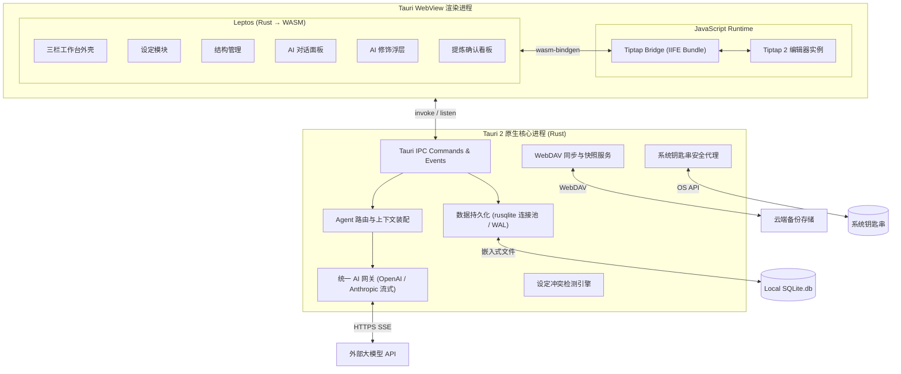

# Easy-writing · 中长篇小说工作台


> 把**设定、大纲、章节正文**与**多个 AI Agent** 放进同一界面的本地写作工作台。
>
> 设定自己长出来 · 结构清晰 · 多 Agent 分工 · 数据完全自主


-EF3939)


---

## 目录

- [项目简介](#项目简介)
- [核心特性](#核心特性)
- [界面布局](#界面布局)
- [技术栈](#技术栈)
- [系统架构](#系统架构)
- [目录结构](#目录结构)
- [快速开始](#快速开始)
- [配置指南](#配置指南)
- [数据与安全](#数据与安全)
- [数据库设计](#数据库设计)
- [后端命令一览](#后端命令一览)
- [开发路线图](#开发路线图)
- [相关文档](#相关文档)

---

## 项目简介

**Easy-writing** 是一款面向独立中长篇小说创作者的**本地桌面写作工作台**，按 **100 万字 / 300 章**的单部体量进行数据流与渲染性能设计。

它要解决四件事：

1. **设定自己长出来** —— 世界观、角色、剧情、大纲可以一开始留空，写正文时由 AI 从章节内容中提炼成候选条目，你确认后才入库。
2. **结构清晰** —— 作品按「卷 → 章」组织，右栏管理结构，中间只管写。
3. **AI 贴身、多 Agent 分工** —— 六个预设 Agent 各司其职，可分别绑定不同的大模型接口；对话框只作用于正文，并严格按设定写作，冲突时先问你。
4. **数据自主** —— 单机 SQLite 文件 + 图片文件夹，密钥存系统钥匙串，整库经 WebDAV 备份，不依赖第三方账号。

---

## 核心特性

| 模块 | 能力 | 状态 |
| --- | --- | --- |
| **作品管理** | 作品（小说名 + 全篇梗概）的增删改查、软删除 | ✅ MVP |
| **设定管理** | 左栏四类设定：世界观条目、角色卡、剧情梳理（主线/冲突/伏笔 + 已埋/已回收）、大纲（全篇梗概 / 卷纲 / 章纲） | ✅ MVP |
| **结构管理** | 卷目与章节的增删改、拖拽排序、跨卷移动、章节状态（草稿 / 修改中 / 定稿）、字数统计 | ✅ MVP |
| **写作台** | 基于 Tiptap 的富文本编辑：H1–H3、加粗、斜体、下划线、对齐、引用、分隔线、列表、图片、撤销重做 | ✅ MVP |
| **大纲单一事实源** | 大纲里的卷纲/章纲与右栏卷简介/章摘要共用同一份数据 | ✅ MVP |
| **AI 修饰** | 六处输入框的「✨ AI 修饰」，原文与润色稿并排对比，采用 / 重试 / 放弃 | ✅ MVP |
| **AI 对话** | 写作助手对话框，流式输出（40ms 微批处理）、自动装配设定上下文、插入光标 / 替换选中 | ✅ MVP |
| **冲突检测** | 生成内容与设定冲突时弹出裁决卡：修改设定后继续 / 换一种写法 / 取消，改动留档 | ✅ MVP |
| **AI 提炼** | 「提炼本章」触发世界观、角色、剧情、大纲四个 Agent 并行提炼（信号量限流），候选逐条采纳 / 编辑 / 忽略 | ✅ MVP |
| **多模型接口** | OpenAI 兼容 / Anthropic 兼容两种协议，多套配置，测试连接，密钥入系统钥匙串 | ✅ MVP |
| **WebDAV 同步** | 先增量上传图片（SHA-256 去重）→ SQLite 一致性快照 → gzip 压缩 → 原子上传；按时间列出备份并恢复 | ✅ MVP |
| **保存机制** | 手动保存（⌘/Ctrl+S）、脏标记、30s 定时自动保存、保存状态提示 | ✅ MVP |
| **图片资产** | 通过 `asset://` 协议渲染本地图片，文件按内容哈希命名 | ✅ MVP |
| 深色模式 | Tailwind `dark:` 类与 CSS 变量基础已就绪 | 🚧 待接入切换入口 |
| 回收站 / 版本历史 / 自动提炼 / 选中文字快捷操作 | 见 [P1 排期](<Docs/Easy-writing · 实施计划.md>) | 📋 P1 |

---

## 界面布局

```
+----------------------------------------------------------------------------------------+
|  Easy-writing / 小说工作台        - [ ] x                                              |
+--------------------+------------------------------------------+------------------------+
|  左栏 / 设定       |          中栏 / 写作台                   |      右栏 / 结构       |
|                    |                                          |                        |
|  小说名            |  第一卷 > 第三章        [提炼本章]       |  [ 保存 ]              |
|                    | ---------------------------------------- | ---------------------- |
|  > 世界观          |  H1 H2 H3 | B I U | 左中右 | 列表        |  v 第一卷              |
|  > 角色设定        | ---------------------------------------- |     - 第一章           |
|  > 剧情梳理        |                                          |     - 第二章           |
|  > 大纲管理        |      (富文本正文编辑区)                  |     - 第三章           |
|                    |                                          |  > 第二卷              |
|                    | ---------------------------------------- |                        |
|                    |  字数 1,286  /  已保存                   |  [ + 新建卷 ]          |
|                    |  +----------------------------------+    |                        |
|                    |  | 写作助手（只作用于正文）         |    |                        |
|                    |  +----------------------------------+    |                        |
|                    |                                          |                        |
|  * 设置            |                                          |                        |
+--------------------+------------------------------------------+------------------------+
       左栏可折叠                                                右栏可折叠
```

- 左栏隐藏时，小说名浮到写作台顶部；右栏隐藏时，保存按钮移到写作台右上角。

---

## 技术栈

| 层级 | 选型 | 说明 |
| --- | --- | --- |
| 桌面运行时 | **Tauri 2.x** (Rust) | 原生安全、打包体积小（~15MB）、资源占用低 |
| 前端 UI | **Leptos 0.7**（CSR / WASM） | 细粒度响应式，无虚拟 DOM 开销 |
| 前端构建 | **Trunk 0.21+** | Rust WASM 构建流水线 |
| 富文本核心 | **Tiptap 2 + ProseMirror** (JS) | 成熟可扩展文档模型，JSON schema 直接对接存储 |
| JS 打包 | **esbuild** | 将 Tiptap 与 Bridge 打成自包含 IIFE Bundle |
| 样式 | **Tailwind CSS 3** | utility-first，`darkMode: "class"` |
| 本地数据库 | **SQLite 3**（`rusqlite` + `r2d2`） | 单文件、ACID，天然契合整库镜像备份 |
| 数据库迁移 | 内嵌 SQL（`V001__init.sql`） | 启动时 `execute_batch`，幂等 `IF NOT EXISTS` |
| 密钥存储 | **`keyring` crate** | macOS Keychain / Windows Credential Manager |
| 网络请求 | **`reqwest`**（异步流式） | OpenAI / Anthropic SSE 与 WebDAV |
| 序列化 | **`serde` / `serde_json`** | Rust / WASM / JS 统一规范 |

---

## 系统架构



**关键工程设计**

- **Tiptap 两段式构建**：`esbuild` 打包 `window.TiptapBridge` → Trunk 静态注入 → `wasm-bindgen` 外部符号绑定。
- **切章不销毁编辑器**：切章时先抓取草稿 JSON 做脏检查，仅调用 `set_content` 替换 ProseMirror 文档树，避免白屏与光标抖动。
- **流式节流**：SSE 数据块经 **40ms 微批处理缓冲**后再 emit，避免高频 IPC 拖垮 WASM 渲染。
- **提炼限流**：4 个 Agent 并行提炼时以 `tokio::sync::Semaphore` 限制并发，单个 Agent 失败不影响其余产出。
- **密钥隔离**：API Key 与 WebDAV 密码只经原生层与系统钥匙串，界面仅掩码显示。

---

## 目录结构

```
easy-writing/
├── src-tauri/                       # Tauri 2 后端（服务层）
│   ├── src/
│   │   ├── lib.rs                    # 应用入口、Command 注册
│   │   ├── main.rs
│   │   ├── db/                       # 数据访问层（连接池 + PRAGMA 定制）
│   │   │   ├── mod.rs                # init_db、WAL / 外键 / busy_timeout
│   │   │   ├── novel.rs  volume.rs  chapter.rs
│   │   │   ├── settings.rs           # 世界观 / 角色 / 剧情
│   │   │   ├── agent.rs  extraction.rs  llm_profile.rs  app_setting.rs
│   │   ├── ai/                       # AI 网关层
│   │   │   ├── gateway.rs            # 统一转发、流式缓冲、错误归一化
│   │   │   ├── openai.rs             # OpenAI 兼容协议
│   │   │   ├── anthropic.rs          # Anthropic 兼容协议
│   │   │   ├── context.rs            # 上下文装配与裁剪
│   │   │   └── consistency.rs        # 设定一致性检测
│   │   ├── agent/                    # Agent 调度层
│   │   │   ├── dispatcher.rs         # Agent → 接口 → 密钥 解析
│   │   │   ├── polish.rs             # 六处 AI 修饰提示词
│   │   │   └── extraction.rs         # 4 Agent 并行提炼 + 去重
│   │   ├── sync/                     # WebDAV 同步
│   │   │   ├── webdav.rs             # PROPFIND / MKCOL / PUT / GET
│   │   │   ├── backup.rs             # 增量图片 + SQLite 快照 + gzip
│   │   │   └── restore.rs            # 覆盖恢复与补图
│   │   ├── commands/                 # 暴露给前端的 Tauri Command
│   │   ├── asset.rs                  # 图片哈希、落盘与入库
│   │   └── keyring.rs                # 系统钥匙串读写
│   ├── migrations/V001__init.sql     # 完整建表 DDL 与初始数据
│   ├── icons/                        # 应用图标
│   └── tauri.conf.json
│
├── frontend/                         # Leptos 前端（Rust → WASM）
│   ├── src/
│   │   ├── app.rs                    # 根组件与启动引导
│   │   ├── state/mod.rs              # AppContext（全局响应式 Signal）
│   │   ├── bridge/tiptap.rs          # wasm-bindgen JS 绑定声明
│   │   ├── tauri_api/mod.rs          # invoke 包装
│   │   └── components/
│   │       ├── layout/               # app_shell / writing_stage / panel_toggle
│   │       ├── settings_panel/       # worldview / characters / plot_lines / outline
│   │       ├── structure_panel/      # save_button / volume_list / chapter_list
│   │       ├── editor/               # chapter_nav / editor_wrapper / toolbar / status_bar
│   │       ├── ai/                   # chat_box / polish_* / extraction_modal / conflict_modal
│   │       └── config/               # config_modal（模型 / Agent / WebDAV / 偏好）
│   ├── styles/main.css               # Tailwind 入口 + 主题 CSS 变量
│   ├── public/                       # 构建产物（bridge bundle、styles）
│   └── Trunk.toml
│
├── js/src/tiptap-bridge.js           # Tiptap 核心与 WASM 通信实现
├── shared-types/src/lib.rs           # 前后端共享数据结构
├── Docs/                             # PRD 与实施计划
├── Cargo.toml                        # Rust workspace 根
├── package.json                      # 前端脚本与 npm 依赖
└── tailwind.config.js
```

---

## 快速开始

### 环境要求

| 依赖 | 版本 | 备注 |
| --- | --- | --- |
| Node.js | ≥ 18 | 用于 esbuild / Tailwind |
| pnpm | ≥ 8 | 包管理器 |
| Rust | stable（≥ 1.77） | 含 `cargo` |
| `wasm32-unknown-unknown` | — | `rustup target add wasm32-unknown-unknown` |
| Trunk | ≥ 0.21 | `cargo install trunk --locked` |
| Tauri 系统依赖 | — | macOS：Xcode Command Line Tools；Windows：WebView2 + MSVC 生成工具 |

### 安装

```bash
pnpm install
rustup target add wasm32-unknown-unknown
# 若未安装 Trunk：
cargo install trunk --locked
```

### 开发运行

Tauri 配置里的 `beforeDevCommand` 只负责构建前端静态资源，不启动开发服务器，因此需要**两个终端**：

```bash
# 终端 A：启动 Trunk 开发服务器（http://127.0.0.1:8080，含热重载）
pnpm dev:frontend

# 终端 B：启动 Tauri 桌面壳
pnpm tauri dev
```

> 也可以先执行一次 `pnpm build:assets` 再用 `pnpm tauri dev`，此时 WebView 从 `frontend/dist` 读取已构建产物。

### 生产构建

```bash
pnpm build     # = pnpm build:assets && tauri build
```

构建产物位于 `src-tauri/target/release/bundle/`（macOS：`.app` / `.dmg`；Windows：`.msi` / `.exe`）。

### npm 脚本

| 脚本 | 作用 |
| --- | --- |
| `pnpm build:bridge` | 用 esbuild 打包 Tiptap Bridge 到 `frontend/public/tiptap-bridge.bundle.js` |
| `pnpm build:css` | 用 Tailwind 生成 `frontend/public/styles.css` |
| `pnpm build:assets` | `build:bridge` + `build:css` |
| `pnpm dev:frontend` | 构建资源并启动 `trunk serve` |
| `pnpm tauri` | 透传 Tauri CLI |
| `pnpm dev` | 构建资源后启动 `tauri dev` |
| `pnpm build` | 构建资源后执行 `tauri build` |

### 常用校验

```bash
cargo check --workspace          # 校验 Rust workspace（后端 + WASM 前端 + 共享类型）
cargo test  --workspace          # 运行测试
```

---

## 配置指南

首次启动时应用会自动创建一部「未命名长篇小说」、第一卷与第一章，可直接开始写作。

打开左栏底部的 **⚙ 设置**，界面分四个标签页：

### 1. 大模型接口（LLM）

| 字段 | 说明 |
| --- | --- |
| 名称 | 配置的标识名 |
| 接口协议 | `openai`（OpenAI 兼容）或 `anthropic`（Anthropic 兼容） |
| Base URL | 接口地址，支持第三方中转 |
| 模型名称 | 手动填写 |
| API Key | 存入**系统钥匙串**，不入库、不上传；界面掩码显示 |
| 是否为默认 | 未被 Agent 绑定时使用的接口 |

填写后可点「测试连接」发送一条最小请求验证。

### 2. 预设 Agent

| Agent | 负责模块 | 主要任务 |
| --- | --- | --- |
| 世界观 Agent | 世界观 | 修饰条目；提炼时代 / 地点 / 规则 / 术语 |
| 角色 Agent | 角色设定 | 修饰角色卡；提炼人物、别名与关系变化 |
| 剧情 Agent | 剧情梳理 | 修饰条目；提炼事件、冲突、伏笔与回收 |
| 大纲 Agent | 大纲管理 | 修饰全篇梗概 / 卷纲 / 章纲；提炼章摘要 |
| 卷章 Agent | 卷目 / 章节管理 | 从卷章入口修饰卷简介与章摘要 |
| 写作助手 | 写作台对话框 | 修改 / 重写 / 创作正文，严格遵循设定 |

每个 Agent 可**单独绑定一套接口**，并自定义系统提示词与启用开关；取消绑定则回退到默认接口。

### 3. WebDAV

- 填写服务器地址、用户名、密码、远程目录（默认 `/EasyWritingBackup`），点「保存配置」会同时做一次连通性测试（PROPFIND）。
- 密码存系统钥匙串，不入库。
- **立即备份**：先把新增图片按内容哈希增量上传 → 用 SQLite Backup API 生成一致性快照 → gzip 压缩 → 上传为带时间戳的库文件（不覆盖旧备份）。
- **从云端恢复**：按时间倒序列出远程备份，手动选择；恢复前自动留本地快照，恢复后补下载缺失图片。

### 4. 偏好

- 自动保存间隔（默认 30 秒）。

---

## 数据与安全

| 项目 | 位置 |
| --- | --- |
| 数据目录 | macOS：`~/Library/Application Support/com.easywriting.app`<br>Windows：`%APPDATA%\com.easywriting.app` |
| 数据库 | `easy-writing.db`（附 `-wal` / `-shm`） |
| 图片文件夹 | `<数据目录>/images/`，文件名为内容 SHA-256 |
| 密钥 | 系统钥匙串（服务名 `easy-writing`） |
| 配置/设定/正文 | SQLite |

**安全约定**

- API Key、WebDAV 密码**只存系统钥匙串**，库内仅存 `key_ref` / `pwd_ref` 索引，因此整库上传不含密钥。
- 连接池每个连接强制 `PRAGMA foreign_keys = ON; journal_mode = WAL; synchronous = NORMAL; busy_timeout = 5000;`。
- 删除采用软删除（`deleted_at`），为回收站预留。
- 备份走 SQLite Backup API 生成**一致性快照**，不直接复制写入中的库文件。
- 图片通过 Tauri `asset://` 协议按 `$APPDATA/images/**` 白名单访问。

---

## 数据库设计

单文件 SQLite，共 15 张表（见 [V001__init.sql](src-tauri/migrations/V001__init.sql)）。

| 分类 | 表 |
| --- | --- |
| 作品与内容 | `novel`、`volume`、`chapter`、`asset` |
| 设定 | `worldview_entry`、`character`、`plot_item` |
| AI 与设置 | `agent`、`chat_session`、`chat_message`、`extraction_candidate`、`setting_change`、`prompt_template`、`llm_profile`、`webdav_config`、`app_setting` |

**通用约定**

- 主键 UUID；业务表带 `created_at` / `updated_at` / `deleted_at`；有序数据用 `sort_order`。
- 章节列表查询不读 `content`，只取 `summary` / `word_count` 等轻量字段，正文按章单独加载。
- `chapter.extracted_hash` 记录最近一次提炼的正文指纹，正文未变则不重复提炼。
- **大纲不单独建表**，由 `novel.synopsis`（全篇梗概）、`volume.summary`（卷纲）、`chapter.summary`（章纲）三层合成。

---

## 后端命令一览

<details>
<summary>共 49 个 Tauri Command（点击展开）</summary>

| 分组 | 命令 |
| --- | --- |
| 作品 | `create_novel` `list_novels` `get_novel` `update_novel` `delete_novel` |
| 卷目 | `create_volume` `list_volumes` `update_volume` `reorder_volumes` `delete_volume` |
| 章节 | `create_chapter` `list_chapter_headers` `list_all_chapter_headers_for_novel` `get_chapter` `save_chapter_content` `update_chapter_meta` `move_chapter` `reorder_chapters` `delete_chapter` |
| 设定 | `list_worldview` `save_worldview` `delete_worldview` `list_characters` `save_character` `delete_character` `list_plots` `save_plot` `delete_plot` |
| 图片 | `save_image_asset` |
| AI | `ai_polish` `ai_chat_stream` `ai_check_conflict` `trigger_chapter_extract` `list_extraction_candidates` `resolve_candidate` |
| 配置 | `create_llm_profile` `list_llm_profiles` `delete_llm_profile` `test_llm_connection` `list_agents` `update_agent` |
| 偏好 | `get_app_setting` `set_app_setting` |
| 同步 | `webdav_save_config` `webdav_get_config` `webdav_test_connection` `webdav_backup_now` `webdav_list_backups` `webdav_restore_backup` |

</details>

---

## 开发路线图

| 阶段 | 内容 | 周期 |
| --- | --- | --- |
| **Phase 1** | 基础骨架与跨语言 Bridge、三栏布局、作品/卷/章 CRUD、自动保存 | 2.5 周 |
| **Phase 2** | 编辑器格式与图片协议、章节生命周期复用、四类设定模块、大纲双向同步 | 2.0 周 |
| **Phase 3** | AI 网关与多协议 SSE、Agent 调度与上下文装配、六处 AI 修饰、严格模式对话与冲突拦截、4 Agent 并行提炼 | 3.5 周 |
| **Phase 4** | WebDAV 增量镜像同步、深色模式与偏好、双端打包发布 | 1.5 周 |

**P1 规划**：选中正文快捷操作、章节历史版本、设定冲突撤销、回收站、保存后静默自动提炼、设定全文检索、章节筛选、退出自动备份、虚拟滚动、外部稿件导入。

详见 [实施计划](<Docs/Easy-writing · 实施计划.md>)。

---

## 相关文档

- [框架方案与 PRD](<Docs/Easy-writing · 中长篇小说工作台 框架方案与 PRD.md>) —— 产品需求、界面、AI 能力、数据库与风险应对
- [实施计划](<Docs/Easy-writing · 实施计划.md>) —— 技术选型、架构设计、完整 DDL、四阶段排期与核心时序图

---

## 说明

- 目前为**单用户本地版**，无登录、无多人协作。
- 目标平台为先 macOS 与 Windows；Linux 与移动端暂不适配。
- 词条、回收站、版本历史等标注 P1 的能力尚未实现。
- 仓库暂未附带 LICENSE 文件，如需开源请先补充许可证声明。

---

<sub>Built with Tauri · Leptos · Tiptap · SQLite</sub>
